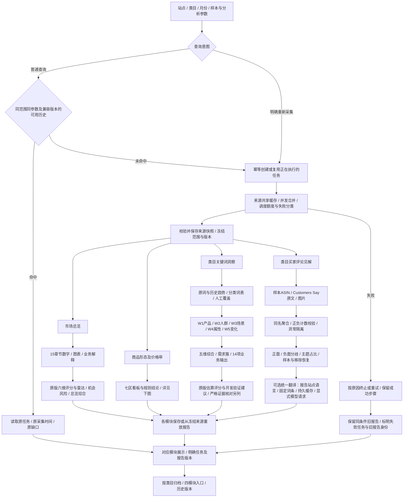
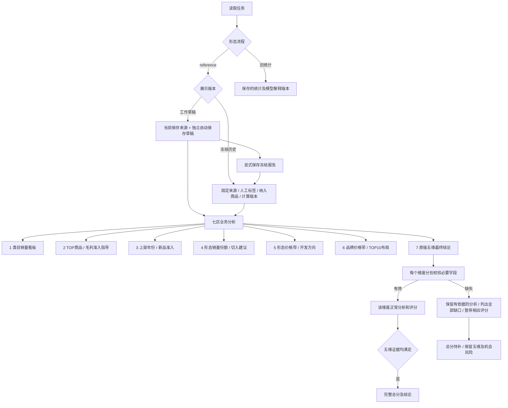
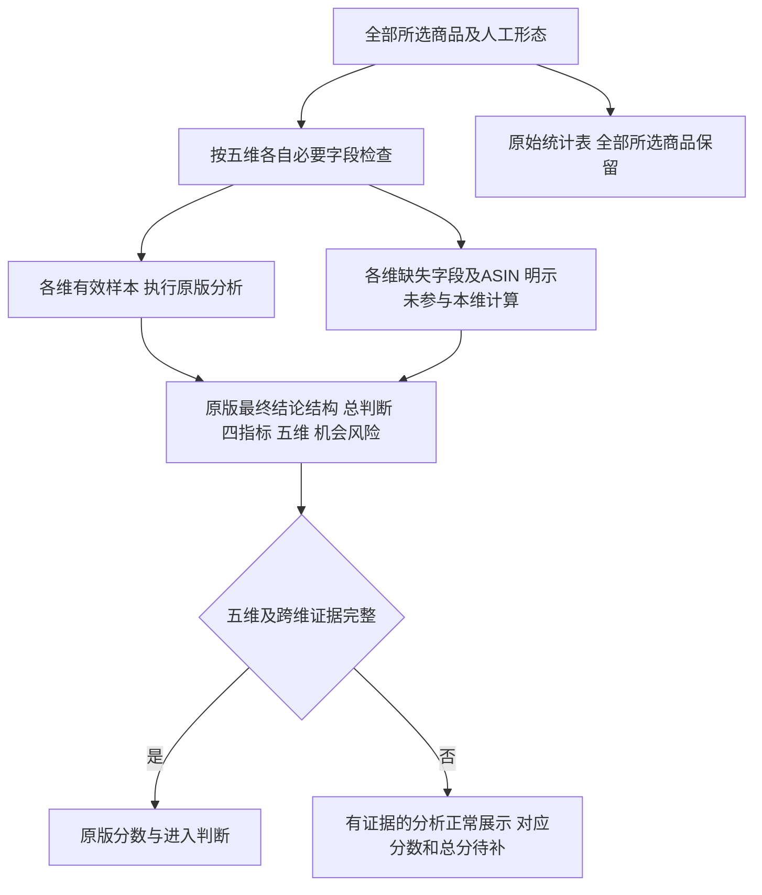

# 市场调研完整业务流程图（2026-10-15 核对版）

范围为市场调研四模块。此图补充2026-09-16的后端调度图，不将当时技术示意图视为业务模块完成证明。原版依据和当前页面证据见 [ZIP核对记录](zip-business-parity-audit-20261015.md)。

图例：实线为已接线的业务路径；虚线指向“已计算但缺展示”或待修事项，**不代表该输出已完成**。原始数据、规则输出、模型解释、人工修订分别标记；普通历史读取不自动调用来源或模型。

## 1. 入口、历史和四模块业务全图

注：图中“各模块保存或重放”不意味着所有原版规则都已搬到后端。新版形态结论目前在浏览器根据已保存来源/修订执行纯规则；旧版语义解释读取后端保存的结果。四模块自动发起仅由明确的总览提交触发；切换页面、编辑输入和读取历史不自动采集。翻译不改变原文计数，不将美国报告变成德国来源报告。

## 2. 商品形态及价格带：原版七区与最终结论

当前七区和五维完整结构已接入。有缺失时按维度保留证据，不再切换为简化总结。历史冻结视图不加载当前草稿，也不会自动覆盖工作草稿；查看历史不触发采集。固定形态目录按站点及明确节点配置，其他类目可自定义。

## 3. 业务模块清单及验收边界

- 市场总览：15章节及总览评分，不应被“总览产物”一个节点吞掉。需求趋势已存在采集阶段、保存合同与页面；旧报告缺阶段和功能未接线需分开。
- 形态价格：七区、各区结论、最终五维及原版细分输出逐项核对。早期 S-01/S-02/S-03 展示缺项已补齐；本轮重点补充冻结历史入口与跨类目规则。
- 关键词：原词表、W1-W5、综合、需求簇、评分与建议分别验收。原版估算分与真实来源充分性不是同一件事；历史报告走不同展示分支。
- 评论：主题、样本、计数、正负栏、移除恢复、翻译分别验收。17/20代表来源覆盖，不能用页面存在声称20/20。
- 跨模块“类目综合结论”：ZIP有定义文件但没有页面调用，不列作原版已上线模块，也未在本图冒充已实现。
- 真实页面核对范围：本轮完成上述形态100件报告；其他三模块本轮为源码级模块对照，先前普通查询复核见 standalone-query-acceptance-20261015.md，不冒充本轮重新验收全部交互。

## 4. 本轮共用规则修复与验收

- Review 区间采用完整数值边界；高评论数不再因以100或50开头误判为低档。
- A+内容机会使用独立四分组证据；需求质量逐项标注退货率、搜索购买比缺口。
- 关键词默认及人工五维、14项输出和开发建议均展示；旧报告可由保存事实恢复本地规则视图。
- 两套关键词投影使用同一语义词典；数值范围需要年龄语境，英语词边界与德语等常见词规则复用。
- 评论样本修订沿用基准主题索引，翻译不随排序串组；隐藏的主题仍保留完整统计分母。
- 总览章节和关键词估算明确标为当前规则派生视图，记录规则版本与结果指纹；原始历史来源及分类版本保持不变。此策略不冒称已经冻结所有旧版派生文案。
- 32900候选环境通过虚拟数据、浏览器及构建检查后交用户验收；31900保持原版本。

## 最终结论逐维呈现（2026-10-15，替换简化阶段总结）

各维有效样本分母明示；不补0、不隐式删除商品，不合并不同范围的分数。独立上架/毛利/形态/品牌总结也显示有效样本口径。完整输入保留原规则，缺形态不将“未分类”当成已确认形态。
