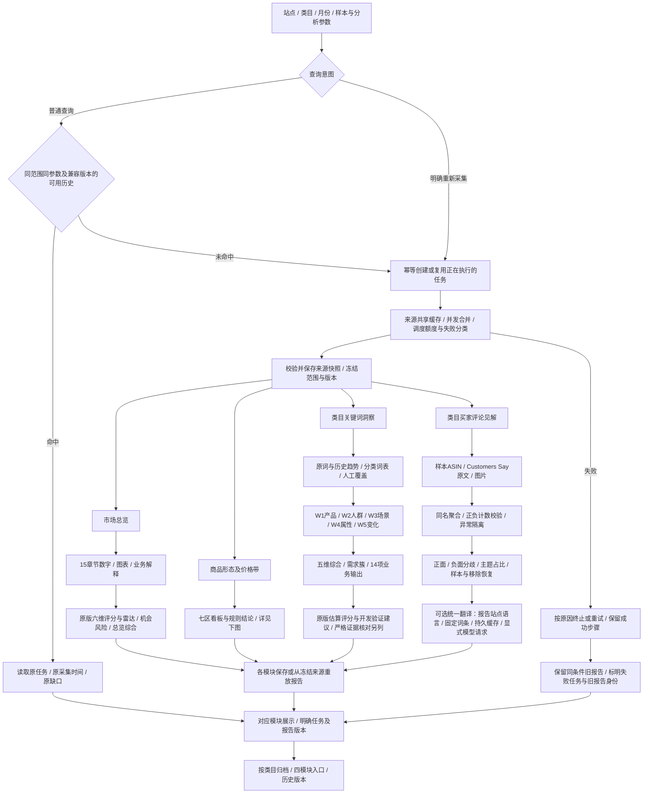
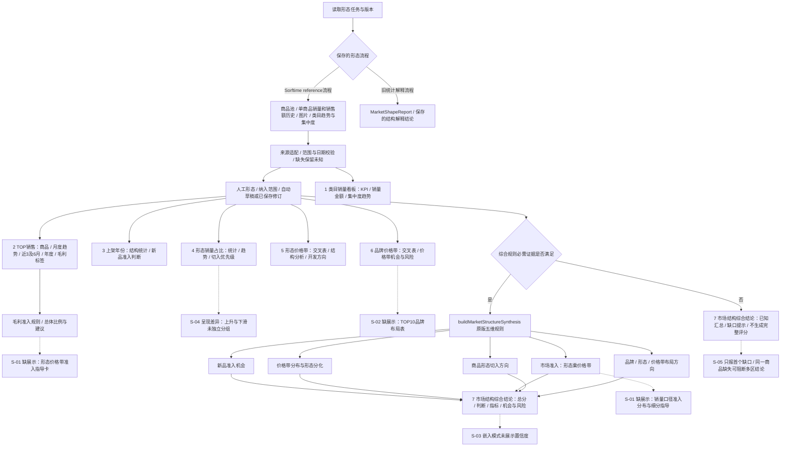
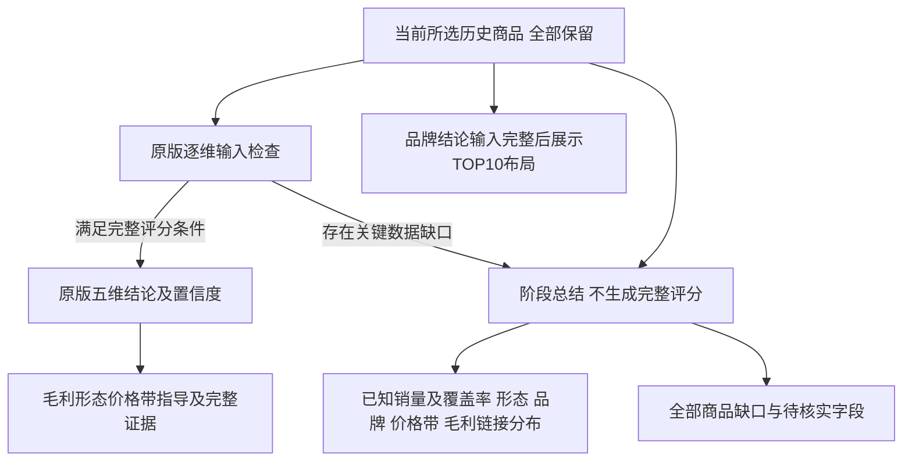

# 市场调研完整业务流程图（2026-10-15 核对版）

范围为市场调研四模块。此图补充2026-09-16的后端调度图，不将当时技术示意图视为业务模块完成证明。原版依据和当前页面证据见 [ZIP核对记录](zip-business-parity-audit-20261015.md)。

图例：实线为已接线的业务路径；虚线指向“已计算但缺展示”或待修事项，**不代表该输出已完成**。原始数据、规则输出、模型解释、人工修订分别标记；普通历史读取不自动调用来源或模型。

## 1. 入口、历史和四模块业务全图

注：图中“各模块保存或重放”不意味着所有原版规则都已搬到后端。新版形态结论目前在浏览器根据已保存来源/修订执行纯规则；旧版语义解释读取后端保存的结果。四模块自动发起仅由明确的总览提交触发；切换页面、编辑输入和读取历史不自动采集。翻译不改变原文计数，不将美国报告变成德国来源报告。

## 2. 商品形态及价格带：原版七区与最终结论

原版“类目商品链接调研 · 最终结论”对应现在“市场结构综合结论”，是第七区。五维分项各有评分，总体结论仍非最终产品立项决策。

当前真实实例：US / 1063294 / 2026-09 / 100件，任务 `4e32df59-8e19-4d51-bb52-8fd1a10b9aee` 在 GATE 走“否”，提示 `B0GQTGDTF9` 缺近6个月销量。当前门槛逐商品校验；已知合计卡有数字，不等于全体商品的该周期证据齐全。

## 3. 业务模块清单及验收边界

- 市场总览：15章节及总览评分，不应被“总览产物”一个节点吞掉。需求趋势已存在采集阶段、保存合同与页面；旧报告缺阶段和功能未接线需分开。
- 形态价格：七区、各区结论、最终五维及原版细分输出逐项核对。S-01/S-02/S-03 为本次发现的展示缺项，仍未修复。
- 关键词：原词表、W1-W5、综合、需求簇、评分与建议分别验收。原版估算分与真实来源充分性不是同一件事；历史报告走不同展示分支。
- 评论：主题、样本、计数、正负栏、移除恢复、翻译分别验收。17/20代表来源覆盖，不能用页面存在声称20/20。
- 跨模块“类目综合结论”：ZIP有定义文件但没有页面调用，不列作原版已上线模块，也未在本图冒充已实现。
- 真实页面核对范围：本轮完成上述形态100件报告；其他三模块本轮为源码级模块对照，先前普通查询复核见 standalone-query-acceptance-20261015.md，不冒充本轮重新验收全部交互。

## 4. 后续修复顺序（尚未实施）

1. 恢复 S-01 毛利细分指导和 S-02 TOP10品牌布局；只消费现有规则结果，先补有效/缺失输入回归。
2. 恢复 S-03 置信度及标题对应关系；不要为补显示改变评分。
3. 对 S-05 汇总所有缺口、说明影响；若要部分评分，先定义范围、覆盖率和版本规则，不默默排除商品。
4. S-04 是否恢复单独分组按业务展示需求决定。
5. 只在32900验收；31900继续等待用户明确批准。

## 总结呈现补齐（2026-10-15）

阶段总结不将缺失值补零，不排除缺失商品，不把链接数量分布当成销量占比。原版完整分数和准入判定的门槛不变。
