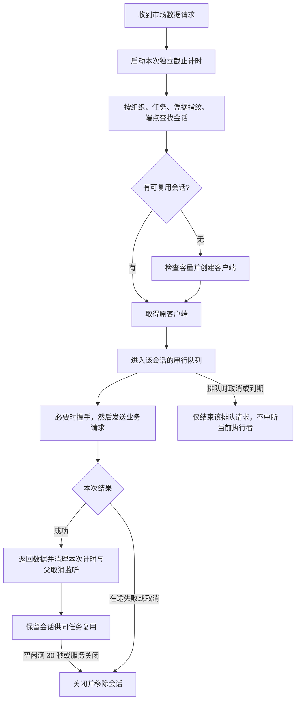
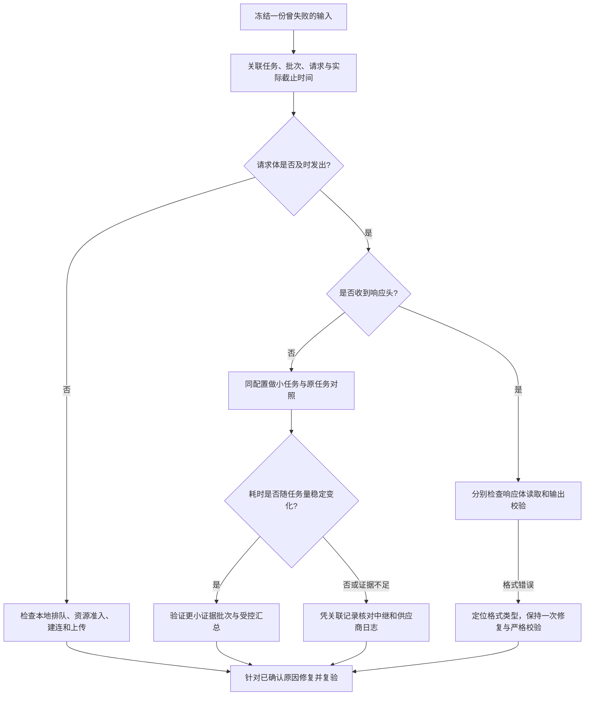

# MCP 会话复用与模型超时排查方案

日期：2026-09-17。状态：解释现有实现与提出后续方案，尚未实施下面的新建议。本次核对代码与已保存 R2/R3 真实调用证据，没有新增付费调用或修改正式配置。

## 1. 两条调用链

当前池复用 MCP Client 和协议会话，由每个卖家精灵连接器持有，不是全局共用账号，也不保证底层永远使用同一个 TCP 连接。模型 API 调用不经过这个池。数据采集成功不代表后续模型分析已成功。

## 2. 当前会话池流程

- 每个池默认最多 32 个会话。容量满时可淘汰空闲会话；全忙则拒绝新建，不无界扩张。
- 同会话串行，不等于整个系统只允许一个任务运行。不同组织、任务或凭据分别隔离。
- 排队时间也占用本次截止时间。空闲保留时间与单次请求超时是两个计时器。
- 握手、GET 监听尝试、业务请求等每个实际 HTTP 发送前都经过资源治理。图中的握手/请求节点包含这项逐次检查。
- 本地窗口不足且尚未发送时，调度器按安全 retryAt 等待并重新准入。若业务请求已发送后失败，保留不自动重放约束，避免重复消耗与不明确的远端状态。
- 正常完成只清理本次计时器，不主动 abort 已完成信号。真正的在途超时、用户取消和服务关闭仍有效。

已修复缺陷：SDK 1.30.0 保留成功 RPC 的 abort listener，旧的不可清除超时信号随后触发取消通知。现在完成时清除独立计时器并断开父取消转发。R3 的 13 次业务查询实测为 16 次 HTTP（13 业务 + 初始化 + 初始化通知 + GET），R2 为 30 次，额外 14 条迟到取消通知已归零。仍按实际 HTTP 计量，不等同于供应商付费次数减少 14 次。

## 3. 当前超时的证据与未知项

| 环节 | 已确认的证据 | 能得出的结论 |
|---|---|---|
| MCP 采集 | R3 总览 13 次查询完成，12 成功、1 来源为空 | 此轮模型失败发生在采集之后；池的迟到取消已解决 |
| 总览模型 | R3 约 59.977 秒、无响应头、到达 60 秒单次上限 | 单次模型等待触发超时；不能据此断定供应商内部原因 |
| 主题模型 | R3 请求体约 186ms 发出，119.985 秒仍无响应头 | 长时间等待发生在请求发出后；bodySent 不代表远端已经处理 |
| 关键词模型 | R2 约 90 秒无响应头；R3 未重新付费测试 | 保留未通过状态，不能用 R3 其他模块结果覆盖 |
| 形态模型 | R3 既有成功，也有两次 invalid_json；额外单次诊断约 5.153 秒返回合法 JSON | 端点并非完全不可用；格式波动与超时须分别处理 |

超时触发条件与慢响应根因是两回事。目前尚不能确认是中继排队、转发、供应商限流等待、模型生成耗时、响应缓冲还是其他网络环节，也没有证据证明并发量或输入长度就是根因。模型名是当前配置的别名，不据此认证中继后端实际运行的模型。

当前形态/主题默认单次上限仍为 60 秒，独立配置可显式设置到 120 秒；R3 测试显式采用 120 秒，不能视为正式环境已修改。总览解释当前上限 60 秒，关键词 90 秒。外层另有 batch/stage 截止时间；延长单次时间不能越过这些边界。

还确认一个诊断缺口：执行器超时调用 abort(new Error(...))，网络日志只把名为 TimeoutError 的原因识别为 timeout，因此本地单次超时可能显示 signal-aborted。终态审计仍记录 timeout，这个标签缺口没有造成供应商慢响应，但会干扰排查。当前安全网络日志主要关联 task 和请求随机 ID；底层 bodySent 仅在本地验收脚本观察，不是正式运行时已完整提供的能力。

## 4. 建议的排查与修复顺序

### 第一步：完善可定位的时间记录

统一闭集取消原因，区分单次请求超时、批次截止、阶段截止、用户取消及租约失效；不要通过匹配任意错误文本判断。将 run/batch/attempt、请求 ID、输入与 schema 摘要、实际时间上限和网络阶段关联起来，保留安全的请求体发送/首响应头/响应结束时间。各计时边界应可解释，响应取消与迟到用量仍按原有保护处理。不得记录密钥、完整提示词、供应商响应原文或客户内容；底层诊断订阅应有生命周期清理与并发归属测试。

### 第二步：用冻结数据做有界对照

固定端点、配置、模型别名、传输协议和证据，串行比较微小合法任务、原失败任务、保持证据完整但减少单批成员的候选。预先限定调用与 token 总预算，记录冷却/额度与缓存影响；候选每个只做少量可比较重复，单次成功不能视为稳定性结论。通过客户端关联 ID 与提供方支持的 request ID 核对中继记录，不把本地生成的 ID 当作远端一定可查到的 ID。

### 第三步：证据决定改哪一层

- 若单批工作量与慢响应的关系可重复：主题当前最多 12 条主题一批，可对照 6 条/3 条候选；按主题条目和文本量规划，不按 ASIN 数量拍脑袋划分。总览已经按窗口处理，评估更小窗口而非宣称尚未分批；形态已经单商品，不再靠重复“单商品拆分”解决问题。每条原始证据必须覆盖且保留原 ID、ASIN、归属，跨批归并继续严格校验。更多小批可能增加总请求与总费用，不自动提高预算。
- 若小任务也出现明显波动：先修复或调整中继/供应商侧队列、转发或路由问题。只有核实兼容性与费用后才考虑受控更换，不自动切换端点或凭据。
- 若合法结果稳定出现在旧上限之后：根据实际延迟分布评估时间上限，同时检查 batch/stage 时间和费用边界。主题 120 秒仍失败，当前没有依据把“统一延长到 180 秒”作为通用修复。
- 若已收到响应却 JSON 失败：核对完整响应、是否截断、围栏格式和输出上限执行情况；只补充有证据的兼容，不能提取任意片段、补猜字段或放宽业务引用。保留最多一次格式修复。
- 如果只错引文坐标：继续使用现有同 ASIN、同引用字段、唯一字面匹配定位；模糊、跨产品或找不到引用仍拒绝。unknown 是证据不足的业务结论，不能作为格式失败的兜底掩饰。

### 验收条件

先用同一批冻结失败样本验证，再用新样本确认：来源与成功历史保留、引用与完整覆盖通过、任务正常到达终态、截止时间可解释、取消不重复派发、没有越过预算。已知超时样本应有少量连续成功证据；失败应明确显示失败/部分结果，不能用取消余下任务或延长等待假装通过。只读打开历史不再触发调用。

涉及分批、提示词或时间策略的候选在确认后更新 OpenSpec、版本身份及兼容测试；本说明不自动批准上线。正式配置和前端在本轮未修改。

## 5. 核对来源

- `scripts/lib/sellersprite-session-pool.mjs`
- `server/runtime/market-model-config.ts`
- `server/skills/market-semantic-task-definitions.ts`
- `server/domain/market-research/semantic-batch-plan.ts`
- `server/runtime/skill-runner.ts`
- `server/runtime/model-network-diagnostics.ts`
- `openspec/changes/enable-market-backend-evidence-flow/reliability-fixes-20260917-r3.md`
- `openspec/changes/enable-market-backend-evidence-flow/local-real-model-retest-20260917-r2.md`
- `.superpowers/sdd/market-local-real-retest-20260917-r3/events.jsonl`
