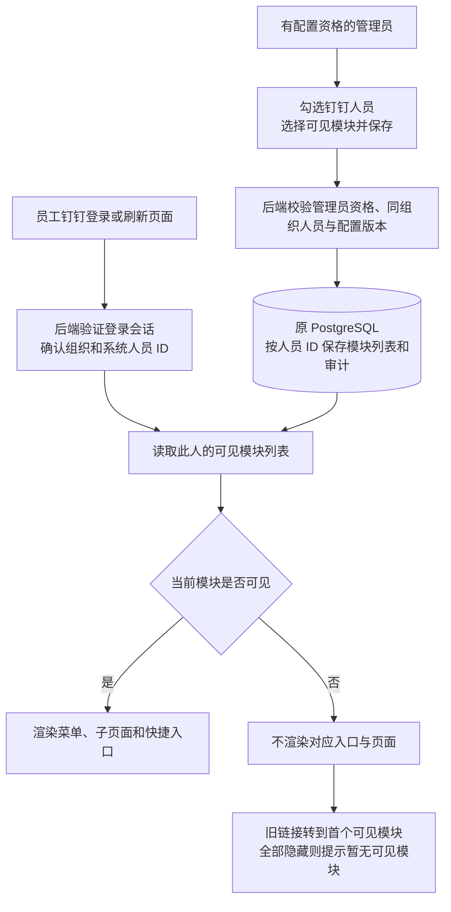

# 人员批量勾选与模块显示原理

## 操作

每个人员行前增加复选框，列表顶部「全选当前页」一次选择当前页，支持部分选择状态。选中后点击「批量配置可见模块」，选择统一的模块列表并保存。当前每页最多 10 人；搜索、翻页、刷新会清空人员勾选。

批量弹窗初始勾选是这些人员共同显示的模块。保存会统一替换所选人员的模块列表，不是追加模块。取消不写入。复用逐人保存接口：每人独立校验和写入审计；部分失败显示成功人数与失败人员，重试仅提交剩余失败人员。并发版本冲突需要取消并重新打开。

## 流程图

钉钉负责身份确认，系统使用已绑定的内部人员 ID 存储配置，不依靠姓名匹配，因此同名人员不会共用设置。系统没有把这里的模块配置同步到钉钉通讯录或钉钉权限后台。

无配置时保留原显示范围；明确保存空列表才表示全部隐藏。父模块与子页统一判断。收藏中的业务页面同时要求「收藏夹」和对应业务模块可见。

## 两种权限的区别

| 层次 | 当前行为 |
| --- | --- |
| 谁可以修改配置 | 后端沿用原专用管理资格，每次保存重新校验；不以任意管理员角色字段代替 |
| 员工看到什么 | 认证会话携带 visibleModules，前端过滤导航；页面入口在挂载业务组件前判断 |
| 业务接口能做什么 | 保留原接口授权；这次没有新增按模块的服务端数据访问限制 |

隐藏页面是代码选择不渲染该页面组件，不只是 CSS 隐藏。数据仍保存在原数据库，后台分析流程仍正常执行。模块隐藏不能作为敏感数据隔离手段；若以后要求不可读取某模块的数据，需要另行实现服务端接口鉴权。

「用户与使用统计」还需要原查看资格，单独勾选不会授予资格。有配置资格的人即使隐藏统计入口，仍保留模块配置入口，方便改回。

读取发生在登录会话请求中，刷新生效，不新增轮询或心跳。代码涉及 module-visibility-panel.tsx、module-visibility-store.ts、auth.ts、app/lib/module-visibility.ts 与主页面入口。

## 验证

浏览器测试覆盖当前页 10 人全选、半选、翻页及搜索清空、取消无写入、统一保存、未选中人员不变、部分冲突及重试不重复写入已成功人员。原单人配置及模块显示测试同时通过。截图位于 .superpowers/sdd/module-visibility-bulk.png。

并行图片状态改动曾触发类型不匹配，由「新新指令窗口」修正并完成回归后冻结源码，统一使用受管本地更新，避免两个窗口同时切换服务。

受管本地更新已完成：Web/Agent 健康均为 ok，实际源码及两个服务指纹一致：c458999d6e10f7372d5315e2502c6ebdb921487f35e471b1050b1d8d0b90ce0c。构建日志 visibility-bulk-local-update.log。
