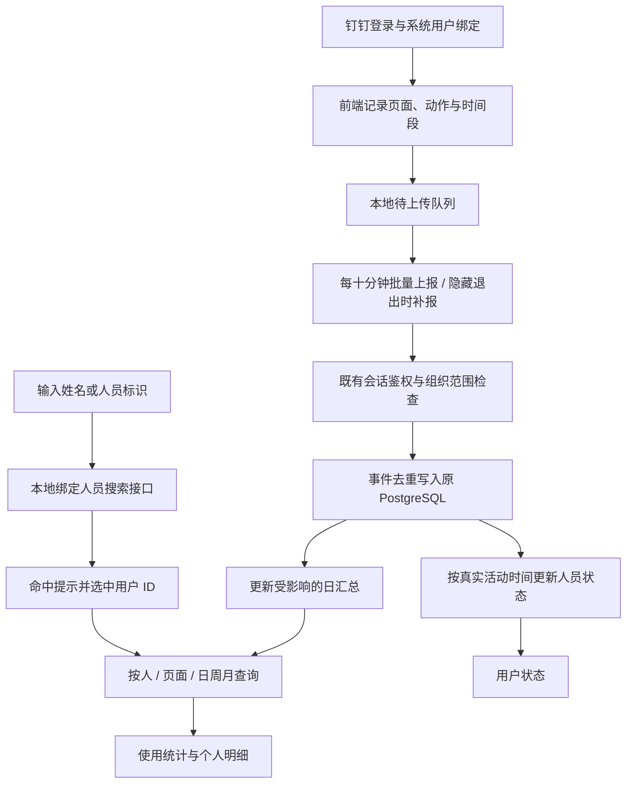

# 钉钉人员使用统计实施计划

> **For agentic workers:** 使用 `executing-plans` 在当前任务中按顺序执行。每完成一项，更新复选框和验证结果；不另开并行开发任务。

**Goal:** 在现有管理入口增加按钉钉人员、业务页面、日/周/月统计的使用分析，支持具体年月日查询及人员关键词搜索。

**Architecture:** 复用现有认证、`/v1/auth/activity` 和 PostgreSQL。前端累计访问、交互与时间段，每 10 分钟批量上报；后端鉴权、去重入库并更新受影响的每日汇总，管理页面查询这些汇总。保留现有用户状态能力，通过同一入口的两个视图呈现。

**Tech Stack:** 当前仓库的 React、TypeScript、Fastify、Zod、pg；沿用现有测试工具，不引入第三方统计平台。

**状态：** 五项任务已实施，本地正式栈于 2026-09-14 16:29:37（北京时间）启用，可开始人工测试。运行证据和限制见 [验收记录](../../repairs/2026-09-14-usage-analytics-acceptance.md)。代码尚未提交，以验收记录中的源码指纹确认实际版本。

**实施校准：** 人员搜索、页面及 IndexedDB 的交互验证集中在真实浏览器 `tests/smoke/usage-analytics.ts`，不再分拆同内容的组件测试文件。局域网 HTTP 下用 IndexedDB 事务补充 Web Locks 发送协调；正文加入 `accountKey` 仅用于校验当前账号一致性，归属仍完全由后端会话决定。压测采用隔离库批次回放，连接等待未单独测量，限制已记录。保留原架构，不增加后台 Worker 或定时汇总进程。

## 一、确认的范围与约束

- 正常周期上报为 **600,000 ms（10 分钟）**，替换现有 60 秒周期，不新增第二条每分钟心跳。
- 登录进入后立即上报；隐藏、退出时尽力补报。普通模块切换仅在本地结束上一段并记录下一段，不每切一次就请求后端。
- 前端计时与网络上报分开：网络每十分钟一次，不代表时间固定增加十分钟。
- 后端收到后入库、汇总；**不再等待第二个十分钟定时器**。第一版不新增常驻汇总进程、Worker、消息队列或 WebSocket。
- 人员身份必须来自服务器验证的登录会话及 `auth_identities` 钉钉绑定。展示姓名，筛选使用稳定的系统用户 ID；禁止按姓名归并同名人员。
- 心跳和搜索不调用钉钉远程接口。搜索只查询同组织已有绑定用户，不额外申请通讯录、部门、手机号权限。
- 使用统计第一版面向原 PostgreSQL 环境；SQLite 保留既有登录和状态功能，使用统计能力不可用时明确返回 503，不用假数据替代。
- 管理查看权限复用 `UserPresenceAccess.canView`，包括现有组织和指定人员限制，不能简化成“任何 admin 都可查看”。
- 页面为“用户状态 / 使用统计”两个视图，沿用主页蓝白色、卡片、表格与导航样式。
- 本次不改采集、VOC、四个市场调研模块的业务逻辑；只添加必要的页面标识和交互采集接点。
- 不把审核原型示例数据导入数据库。真实统计从功能启用后开始；启用前显示“尚未开始采集”，与已采集但零次使用分开。

## 二、交互与统计口径

### 人员搜索

1. 默认全部人员；输入框提示“搜索姓名 / 人员标识”。
2. 输入姓名片段或系统人员标识，忽略首尾空格与英文字母大小写；第一版不做拼音搜索。
3. 下方显示命中数量、姓名、用于区分重名的人员标识和钉钉绑定状态，高亮匹配文字。高亮通过文本节点/React 文本构建，不把输入拼进 HTML。
4. 输入期间只显示建议；点击候选或方向键加 Enter 后，才按其 `userId` 应用筛选。下拉中显示当前已经应用的人员，避免输入与筛选状态混淆。
5. 清空恢复全部人员；Escape/离开输入框取消未确认输入，恢复已选人员文案。无匹配显示提示，不自动选择其他人。
6. 生产搜索请求防抖 300 ms，最多返回 20 人，有 `hasMore` 时提示继续输入；取消旧请求并用请求序号避免旧响应覆盖新输入。相同关键词短期缓存，不逐字请求。
7. 搜索响应只返回同组织且当前查看者有权限访问的人员。未绑定用户显示在既有用户状态中，但不会冒充钉钉人员出现在“钉钉人员”候选中。

### 时间与计数

| 指标 | 规则 |
|---|---|
| 页面访问 | 首次进入或真正切换业务模块记一次；重新渲染、同步进度参数变化不新增访问。浏览器刷新是一次新访问。 |
| 交互点击 | 记录有稳定动作标识的业务按钮、链接操作；不采集空白点击、输入内容或 VOC 正文。 |
| 停留时长 | 页面可见期间累计；隐藏、休眠时暂停。 |
| 有效使用时长 | 可见、有焦点且最近 5 分钟有点击/按键/滚动/触摸操作；过期暂停，恢复后重新开始，不补记空闲间隔。 |
| 使用人数 | 统计周期内按组织和用户 ID 去重。周/月人数不能直接加总每日人数。 |
| 人员状态 | 最近 15 分钟内有已确认的活动为“近期有活动”；不是实时在线，也不是钉钉客户端状态。 |
| 日期 | 北京时间；日为 00:00 至次日 00:00，周为周一至下周一，月为自然月，查询采用左闭右开区间。 |

“日”视图支持选择某年某月某日，默认今天且不能选择未来日期。人员、页面筛选与日期同时生效；个人明细继承选定日期。“用户状态”始终显示当前状态和今日数据，不被历史日期筛选改写。周视图使用当前自然周，月视图使用当前自然月；统计只累计到现在，页面显示具体区间。原型中固定的示例日期/上周仅为演示，生产实现不能写死。

同一人的重叠时间段在个人总时长中取并集；同一页面内也去重。跨设备同时使用不同页面时，页面时长之和可能大于个人总时长，页面口径说明这一点。后台采集任务运行时长继续来自任务记录，不计入人的使用时间。

## 三、流程



## 四、当前代码接点

执行根目录：`C:/Users/EDY/Amazon-Product-Opportunity-Insights/.worktrees/integrate-xydc-variant-20260905`。

2026-09-14 核查分支为 `codex/integrate-xydc-variant-20260905`。存在运行生成的 `app/*-data.ts` 和其他任务的未跟踪文件；执行时重新检查差异，不覆盖或打包这些文件。

| 已有文件 | 当前情况 / 本次改动 |
|---|---|
| `app/lib/activity-heartbeat.ts` | 现为 60 秒、可见时无正文 POST；扩展为十分钟批量传输，保持唯一控制器。 |
| `app/auth-session-gate.tsx` | 认证后挂载心跳；向采集器传递会话隔离信息，退出时清理监听及待发送状态。 |
| `app/lib/local-agent-browser.ts` | 已有同源代理、JSON 请求头和认证失效处理；复用，不绕过认证。 |
| `server/routes/admin-user-presence.ts` | 活动上报和用户列表入口；兼容旧空正文请求，转交新版批量统计处理。 |
| `shared/admin-user-presence-contracts.ts` | 活动请求目前严格为空对象，近期窗口严格为 300；需同步扩展协议及 900 秒窗口。 |
| `server/db/postgres/admin-user-presence-store.ts`、`server/db/sqlite/admin-user-presence-store.ts` | 两处窗口均为 300,000 ms，同步调整到 900,000 ms。 |
| `server/services/admin-user-presence-service.ts` | 响应窗口从 300 改为 900；保留禁用、从未登录、会话失效等已有状态。 |
| `server/auth/user-presence-access.ts` | 直接复用既有查看权限，不降低限制。 |
| `app/admin/users/admin-users-page.tsx`、`admin-user-presence.tsx` | 原用户状态入口；添加“使用统计”视图，原状态列表和最近登录记录继续可用。 |
| `app/page.tsx`、`app/market-research-section.tsx` | 从 `activeTab`、市场调研内部 `view` 明确发布业务页面切换，不能只监听 pathname。 |

## 五、接口与存储约定

### 接口

- `POST /v1/auth/activity`：旧 `{}` 请求仍可处理且返回 `{ok:true}`；新版正文携带 `usage`，返回确认的事件 ID。新版 ACK 失败或不存在不能删除本地队列。
- `GET /v1/admin/usage/people?q=林&limit=20`：返回绑定人员候选，字段 `userId/displayName/personLabel/bindingStatus` 和 `hasMore`。`personLabel` 使用现有可展示标识，不暴露访问令牌或钉钉凭证。
- `GET /v1/admin/usage?period=day&date=2026-09-14&userId=...&pageKey=...`：`userId/pageKey` 可省略；返回实际日期范围、时区、汇总、人员明细、页面明细、`asOf` 与 `collectionStartedAt`。仅允许 day/week/month，每次查询最多一个自然月。
- 个人展开使用同一统计接口指定 `userId`；不另起个人统计服务。

下面是跨任务使用的 TypeScript 类型约定；Zod 对应字段必须严格校验。

```ts
type UsageEvent =
  | { eventId: string; kind: "visit"; pageKey: string; at: string }
  | { eventId: string; kind: "click"; pageKey: string; actionKey: string;
      at: string; count: number }
  | { eventId: string; kind: "duration"; pageKey: string;
      metric: "visible" | "active"; startedAt: string; endedAt: string };
type UsageBatch = {
  version: 1;
  tabId: string;
  accountKey: string; // 与当前服务器账号核对，不作为归属来源
  observedAt: string;
  events: UsageEvent[];
};
type UsageScope = { organizationId: string; userId: string; sessionId: string };
type UsageQuery = {
  period: "day" | "week" | "month";
  date: string;
  userId?: string;
  pageKey?: string;
};
type UsageTotals = {
  visits: number;
  clicks: number;
  visibleMs: number;
  activeMs: number;
  userCount: number;
};
type UsageAck = { acknowledgedEventIds: string[]; receivedAt: string };
type UsageActivityResponse = {
  ok: true;
  usage?: ({ status: "recorded" } & UsageAck) | { status: "not_bound" };
};
```

`UsageScope` 只能由后端 principal 构造，不属于前端请求正文。事件 ID 为 UUID；页面/动作使用白名单；点击次数为正整数；每段时间必须开始早于结束。单段最长十分钟，跨日拆分；允许补传过去 24 小时的记录，超出则拒绝并返回可识别的原因。单批最多 256 个事件且正文不超过 48 KiB，较大的积压分批传输。`observedAt` 表示记录到的实际活动时间，不等于网络接收时间；补传昨天的记录不能把用户标成刚刚活跃。

会话是否过期始终按服务器当前时间校验，不可把 `observedAt` 当成鉴权时钟。新版活动时间只单调更新为校验通过的观测时间；不能用当前接收时间覆盖历史活动。未绑定的新版请求返回 `usage.status=not_bound`，不确认事件，客户端停止该账号统计，原有登录继续有效。统计未配置返回 503，其他异常走既有错误处理，不返回 `recorded`。

### 两张新增表

1. `usage_events`：组织、用户、原始会话、标签页、事件 ID、发生/起止时间、事件类型、页面、动作、次数和接收时间。唯一键为 `(organization_id, user_id, event_id)`；对同一 ID 不同内容返回冲突，不能默默覆盖。建立组织/用户/发生时间及组织/页面/发生时间索引。
2. `usage_daily_stats`：组织、用户、北京时间日期、统计层级 `user/page`、页面键、访问/点击数、有效/停留毫秒、最后活动时间与更新时间。唯一键为 `(organization_id,user_id,day,scope,page_key)`；user 层的 page_key 为空，page 层为白名单业务页面。

收到一批后，在同一用户的短事务内插入未见过的事件，并重新计算受影响日期的日汇总；汇总是覆盖写，不是无条件累加，避免补传重复。个人层时间段取跨页面并集，页面层取该页面并集。每个事务按用户串行化，锁只覆盖该用户的写入；不阻塞其他用户和采集任务。日周月查询从日汇总读取，使用人数按用户去重；原事件用于补算与核对。

## 六、执行顺序与验收

### 任务 1：数据协议、人员绑定与存储

**新增：** `shared/usage-analytics-contracts.ts`、`server/db/usage-analytics-repository.ts`、`server/db/postgres/usage-analytics-store.ts`、`server/db/migrations/postgres/0047_usage_analytics.sql`。

**修改：** `shared/admin-user-presence-contracts.ts`、`shared/agent-contracts.ts`、`server/db/postgres-repository.ts`、`server/db/repository.ts`。

**测试：** `tests/agent/usage-analytics-contracts.test.ts`、`tests/agent/postgres-usage-analytics-repository.test.ts`。

迁移编号 0047 为核查时下一编号，执行前检查并行任务是否已占用；若占用使用下一空闲编号，不能覆盖其他迁移。新能力作为可选 repository capability 接入；SQLite 不伪装实现生产统计。

- [x] 先添加协议失败用例：客户端传 userId/organizationId、非法页面、负次数、超长时间段、257 个事件均拒绝。
- [x] 实现表、唯一键和索引；仓库对外提供 `ingest(scope: UsageScope, batch: UsageBatch, receivedAt: string): Promise<UsageAck>`。
- [x] 实现事务去重与日汇总，使用既有 `PostgresQueryContext`；迁移先在隔离测试库运行两次，验证幂等及原用户、会话、业务表不受影响。
- [x] 验收：同批重复两次计数不变；同名不同 ID 分开；不同组织不能读取对方数据；跨日 23:59—00:01 分别归属两天各一分钟；重叠区间 10:00—10:10 与 10:05—10:15 合计十五分钟。

```powershell
npm exec -- tsx --conditions=react-server --test tests/agent/usage-analytics-contracts.test.ts tests/agent/postgres-usage-analytics-repository.test.ts
```

预期：上述新增用例全部 PASS。数据库测试只使用现有隔离测试容器帮助函数，不连接正式数据库。

### 任务 2：上报、搜索与统计接口

**新增：** `server/services/usage-analytics-service.ts`、`server/routes/usage-analytics.ts`。

**修改：** `server/routes/admin-user-presence.ts`、`server/app.ts`、`server/auth/authorization.ts`、两种数据库的 `admin-user-presence-store.ts`、`server/services/admin-user-presence-service.ts`。

**测试：** `tests/agent/usage-analytics-routes.test.ts`、`tests/agent/usage-analytics-service.test.ts`；更新已有 presence 合同、服务、路由和两个数据库的 300 秒窗口断言。

- [x] 实现上述三个接口；查询均调用既有 `canView`，并强制组织范围。无会话 401、无查看权限 403、无统计存储能力 503。
- [x] 人员搜索查询 `users` 与 `auth_identities` 的已有绑定；SQL 参数化，转义 LIKE 的 `%/_`，不直接拼接用户输入。分隔符、重名与大小写有确定行为。
- [x] 只接受后端会话确定的身份；未绑定普通账号的旧活动心跳继续成功，新版统计正文返回明确的“未绑定钉钉”状态，前端停止该账号的统计采集，不触发业务退出。
- [x] 保留空正文旧心跳兼容；新正文成功后返回事件 ACK。服务不可用不返回虚假的确认，旧队列留待重试。
- [x] 将近期窗口的合同、服务和 PG/SQLite 查询统一为 900 秒；较早的补传不回写为当前在线。状态页用“近期有活动”等文案。
- [x] 验收：人员搜索防跨组织、管理员权限不扩大、历史记录补传不刷新为在线、无绑定登录不受影响、日/周/月与北京时间边界正确。

```powershell
npm exec -- tsx --conditions=react-server --test tests/agent/usage-analytics-routes.test.ts tests/agent/usage-analytics-service.test.ts tests/agent/admin-user-presence-contracts.test.ts tests/agent/admin-user-presence-routes.test.ts tests/agent/admin-user-presence-service.test.ts tests/agent/user-presence-access.test.ts tests/agent/auth-authorization.test.ts
```

### 任务 3：唯一采集器与十分钟批量上报

**新增：** `app/lib/usage-analytics-browser.ts`、`app/lib/usage-analytics-queue.ts`、`shared/usage-page-catalog.ts`。

**修改：** `app/lib/activity-heartbeat.ts`、`app/auth-session-gate.tsx`、`app/page.tsx`、`app/market-research-section.tsx`；在已有业务按钮上添加必要的 `data-usage-action` 标识。

**测试：** `tests/agent/usage-analytics-browser.test.ts`、`tests/smoke/usage-analytics.ts`、`tests/agent/activity-heartbeat.test.ts`。

- [x] 用共享常量明确网络周期和状态窗口：

三个常量定义在 `shared/usage-analytics-contracts.ts`，控制器、状态服务和两种数据库查询统一导入，避免 300/900 秒或 60/600 秒分别写死。

```ts
export const USAGE_REPORT_INTERVAL_MS = 600_000;
export const RECENT_ACTIVITY_WINDOW_MS = 900_000;
export const USAGE_IDLE_THRESHOLD_MS = 300_000;
```

- [x] 在已认证根节点只挂载一次；提供 `setPage(pageKey: string)`、`recordAction(actionKey: string)`、`flush(reason: "scheduled" | "hidden" | "logout")` 三个入口。统计监听键盘时只更新活动时间，不保存按键内容。
- [x] 本地用短采样检查计时连续性，合并连续时间段；采样不产生网络请求。可见性/焦点变化及闲置到期结束对应段；异常长计时跳跃不把休眠整段计入。
- [x] 普通切页不发送请求；切页先结束旧页面段再建立新页面段。四个新子模块必须有四个独立页面键，URL 上 syncJob 等参数不作为页面身份。
- [x] 复用同源 `localAgentFetch`；隐藏/退出补报可用 keepalive，正文保持小于 48 KiB。失败保留事件 ID 重试，ACK 后才删除；401 停止发送，禁止无限重试影响业务。
- [x] 同一浏览器同组织同用户用 Web Locks 协调一个周期发送者，事件存入按组织/用户分区的 IndexedDB 待发送队列；不支持锁时允许幂等补传，服务端继续对时间去重，不能锁死业务。新标签/恢复页面的补报有短时间节流。
- [x] 队列仅保存必要的统计字段；换账号不能带入前一人的事件。退出先尽力发送，下一次只允许同一组织同一用户恢复自身未过期队列；超过 24 小时记录不再补传，不能冒充刚刚发生。
- [x] 验收：首个登录上报后 59 秒、60 秒、599 秒均无周期请求，到 600 秒产生一次；连续 100 次按钮点击仅增加本地计数；隐藏、休眠、闲置、换账号、多标签和重复 ACK 均有明确用例。

```powershell
npm exec -- tsx --conditions=react-server --test tests/agent/activity-heartbeat.test.ts tests/agent/usage-analytics-browser.test.ts tests/agent/web-auth-session.test.ts
```

### 任务 4：管理页面与人员搜索

**新增：** `app/admin/users/usage-analytics-panel.tsx`、`app/admin/users/person-search.tsx`、`app/lib/usage-analytics-query.ts`。

**修改：** `app/admin/users/admin-users-page.tsx`、`app/admin/users/admin-user-presence.tsx`、`app/admin/users/admin-users.module.css`、`app/auth-session-gate.tsx` 的入口文案，以及主页管理导航接点。

**测试：** `tests/smoke/usage-analytics.ts`、`tests/agent/usage-analytics-query.test.ts`。

- [x] 复用原权限和入口，添加“用户状态 / 使用统计”两个视图；保留已有最近登录记录和禁用状态。
- [x] 按原型实现四张统计卡、按人/页面明细、页面分布和个人展开。日期、人员、页面同时决定查询；切页及改筛选时取消旧查询，不能短暂展示另一人的旧数据。
- [x] 实现日历年月日选择；默认日期从北京时间获取，不用浏览器 UTC 日期截取；未来日期禁选，空白或非法值不发请求。展示无数据、尚未采集、加载失败三种不同状态。
- [x] 搜索执行上文七条交互，提供可访问的 combobox/listbox、上下键、Enter、Escape、IME 输入兼容。关键词高亮不改变真实用户身份或匹配范围。
- [x] 验收：输入“林”出现命中提示，选择后只查询对应 ID；输入不存在的人不切换成其他人；清空恢复全部；重名候选可区分；切历史日期同步改变卡片和个人明细，但不改变当前状态页。

```powershell
npm exec -- tsx --test tests/agent/usage-analytics-query.test.ts tests/agent/admin-user-presence-page.test.tsx
```

### 任务 5：联调、负载核对与交付

**新增：** `tests/smoke/usage-analytics.ts`、`docs/repairs/2026-09-14-usage-analytics-acceptance.md`。

- [x] 对测试用绑定用户进行浏览器到 API 到测试数据库联调：访问两个页面、点击、隐藏/恢复、选日期、搜索并展开用户，逐项核对事件与汇总。
- [x] 用虚拟时钟模拟 100 个稳定活跃用户一小时，除登录/退出/补传外，周期请求总量为 600 次；确认没有遗留每分钟请求。测试过程不真实等待一小时。
- [x] 在隔离数据库回放 100 人每十分钟批量数据，记录事件量、批量写入耗时和失败数，并对照无统计上报时数据库基础查询耗时；未独立测量连接等待，详见验收限制。若出现连接排队或超时，先缩短汇总事务和限并发，不引入新的架构。
- [x] 执行现有钉钉、登录、状态、市场调研及流量回归；新增失败必须修复，既有失败提供本次前后证据，不能用“全绿”概括未运行的测试。
- [x] 正式启用前记录代码版本、迁移版本和现有配置，按原流程备份原数据库；只新增统计表并沿用原连接。构建通过后在本地正式栈启用，验证主页、VOC、四个子模块及钉钉登录仍可用。
- [x] 验收文档列出真实可测试地址、采集开始时间、已通过项和可复现限制；遇到统计问题可关闭统计存储能力，入口展示不可用提示，采集降级为原状态心跳；保留原登录/业务功能和统计表数据。

```powershell
npm exec -- tsx --conditions=react-server --test tests/agent/dingtalk-authentication-service.test.ts tests/agent/admin-user-presence-sqlite-repository.test.ts tests/agent/postgres-admin-user-presence-repository.test.ts
npm run test:market-research
npm run test:traffic-regression
npm run build
npm exec -- tsx tests/smoke/usage-analytics.ts
```

## 七、进度与完成标准

- [x] 蓝白主页风格审核原型。
- [x] 指定年月日的日历框及日期联动演示。
- [x] 人员关键词搜索、高亮提示、点击/键盘选择和清空演示。
- [x] 明确十分钟上报、钉钉身份、权限、日周月口径及实施顺序。
- [x] 任务 1：协议及 PostgreSQL 存储通过验证。
- [x] 任务 2：上报、搜索、统计接口通过验证。
- [x] 任务 3：十分钟采集器和账号隔离通过验证。
- [x] 任务 4：真实数据管理页面通过验证。
- [x] 任务 5：联调、负载核对与原业务回归完成。

只有以上五项均有运行证据，才将功能标为“可正式测试”。原型完成不代表后端完成；开发按上述顺序逐项更新，不扩大到其他重构。
