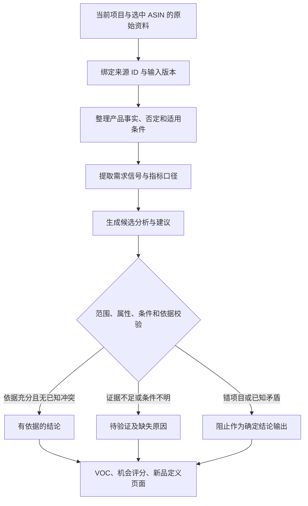

# 产品分析证据校验第一期实施计划

> **For agentic workers:** 使用 executing-plans 技能，在当前任务逐项执行；不自行开启并行任务。步骤用复选框记录，验证通过后才勾选。

**Goal:** 防止产品分析将相关搜索词、类目模板和缺失数据变成确定的产品配置、需求结论及开发建议。

**Architecture:** 在现有 TypeScript 分析链路增加小型、可复用的证据校验函数，先接入 VOC、机会评分和新品定义。沿用现有项目、ASIN、证据 ID、输入指纹和输出契约，不另建分析服务。

**Tech Stack:** TypeScript、React、现有 Zod 契约、node:test/tsx。

**状态：** 已通过 OpenSpec `fix-product-evidence-guardrails` 实施与受控发布。逐项进度以该变更 tasks.md 为准；验收详见 `docs/repairs/2026-09-15-product-evidence-guardrails-acceptance.md`。原计划下列复选框保留规划文本，避免将规划中的方法示例误当成执行日志。

## 全局约束

- 实施目录：`C:/Users/EDY/Amazon-Product-Opportunity-Insights/.worktrees/integrate-xydc-variant-20260905`，分支 `codex/integrate-xydc-variant-20260905`。
- 工作区有其他功能的未提交修改；仅修改本计划相关文件，不清理、不整包提交、不覆盖其他任务成果。
- 不重构整套系统，不新增数据库迁移、消息队列、模型调用或自动付费重采集。
- 原始 VOC、目录、关键词及存档报告保留。规则变化影响重新计算的结果；旧报告不静默改写。
- 有证据的旧功能继续工作；无证据的分数和工程建议改为待验证，不用零分替代未知。
- 本期不是建立全类目知识库，也不承诺代码能理解所有自然语言。不能可靠判定的内容进入待验证。
- 先完成一条“原始证据 → 分析结果 → 页面显示”的链路，再推广至其他模块。

## 一、问题和业务规则

当前已止住部分模板串用，但以下问题仍需系统处理：

| 问题 | 本期规则 | 可见结果 |
|---|---|---|
| 标题含 scooter 就推荐轮组 | 产品族仅用于召回候选；具体配置必须有当前产品的属性证据 | 雪地滑板不出现无依据的轮组方案 |
| lighting 被当成置物落地灯 | 灯具类型与具体属性分开；没有描述不等于没有该功能 | 融蜡灯不自动增加层板、三色温 |
| “不适合冰面”变成使用场景 | 保留否定、条件和所属 ASIN；不把限制条件当成目标场景 | 显示限制或待核实，不推荐冰面使用 |
| 搜索词覆盖当成评论提及比例 | 分开记录搜索量、样本覆盖、评论提及率和旧启发式权重 | 指标有名称、来源；缺分母不展示评论百分比 |
| 缺数据仍给成本、可行性高分 | 未知为 null；不补默认分，也不把已知部分重新放大为满分 | 显示缺哪些证据，综合分待验证 |
| “不耐用”直接变成某材料/零件方案 | 痛点证据支持调查方向；具体工程方案需额外证据 | 可以建议验证结构，不能宣称指定材料已验证 |
| 一个证据 ID 支撑任意结论 | ID 存在、输入范围一致是必要条件；还检查结论是否越过证据边界 | 错范围拒绝，语义支持不明则待验证 |

产品事实用三态：`present / absent / unknown`。`absent` 必须来自明确否定；字段缺失只能是 `unknown`。不同 ASIN、不同年龄或使用条件的证据不能合并成一个无条件结论。

## 二、处理流程



这里的“有依据”不等于商业可行或立项通过。成本、利润、供应链及合规仍按各自证据判断。

## 三、文件与职责

以下路径均相对上述实施目录，实施时以当前文件内容为准。

| 文件 | 工作 |
|---|---|
| 新增 `shared/analysis-evidence-policy.ts` | 范围、三态属性、指标口径、已知冲突的纯函数；不访问数据库 |
| 新增 `app/lib/analysis-evidence-adapter.ts` | 将当前目录、VOC、关键词输入转换为校验输入；保留来源定位 |
| `shared/voc-context.ts` | 复用已有否定判断，补充条件保留；不再散落新的正则 |
| `server/domain/voc/theme-normalization.ts`、`legacy-summary.ts` | 保留原始证据与汇总口径，避免覆盖率伪装成评论比例 |
| `app/product-launch-analysis.ts` | 候选方向校验；移除评分默认值及无依据等级提升 |
| `app/voc-positioning.ts`、`app/final-product-definition.ts` | VOC 与关键词交叉分析、条件冲突、建议状态传递 |
| `server/domain/product/product-definition-contracts.ts` | 在已有范围/ID/指纹校验上接入共用规则，保留现有严格校验 |
| `shared/product-definition-output.ts` | 优先沿用 `requires-validation`、`validate`、`grade: null`；不无故变更持久化版本 |
| `app/product-launch-recommendation.tsx`、`app/local-product-definition-section.tsx` | 显示待验证、指标口径和原因；按实际调用关系同步其他直接消费者 |
| 新增 `tests/agent/analysis-evidence-policy.test.ts` | 核心规则与评分缺失测试 |
| 新增 `tests/agent/analysis-evidence-flow.test.tsx` | 输入到页面的集成回归 |
| 现有 `tests/agent/voc-keyword-page-model.test.ts` 等 | 扩展真实问题回归，保留已修复场景 |

## 四、实施顺序与验收

### 任务 1：建立证据边界，先打通雪地产品实例

交付：同一个雪地产品输入，经 VOC 和新品定义均不能把搜索词 scooter 转成轮组事实。

接口约定：共用规则只接收规范化证据；适配器负责读取已有字段，不反向修改原始数据。证据携带 `id`、`asin`、`source`、`text` 和可用的版本标识；项目及选中 ASIN 范围由当前输入提供。没有来源定位的旧派生文案不升级为原始证据。

核心类型：

```ts
export type FactState = "present" | "absent" | "unknown";
export type CheckResult = {
  status: "supported" | "requires-validation" | "conflict";
  reasons: string[];
  evidenceIds: string[];
};
export type ProductFact = {
  asin: string;
  attribute: string;
  state: FactState;
  evidenceIds: string[];
  condition: string | null;
};
```

- [ ] 新增失败用例：雪地产品仅有 scooter 搜索词时，轮组属性仍为 unknown；含 wheels 的明确产品规格才可支持存在。
- [ ] 新增失败用例：明确“不带轮”产生 absent；未提供轮组信息不能产生 absent。
- [ ] 实现规范化适配及纯函数；词汇命中只能召回候选，不能绕过来源与范围判定。冲突必须保留双方证据。
- [ ] 通过实际 `buildProductLaunchAnalysis` 调用接入校验，再断言最终建议不含确定轮组方案；不能仅测试孤立辅助函数。
- [ ] 执行 `npx tsx --test tests/agent/analysis-evidence-policy.test.ts tests/agent/voc-keyword-page-model.test.ts`，确认新增用例先失败、实现后通过。

### 任务 2：纠正未知评分和指标口径

交付：页面不再用默认 3/4 分填充没有依据的成本、溢价或可行性；低搜索量不被当作伪需求。

先审计 `OpportunityScore` 的全部消费者。将九个评分维度及 `priority/priorityScore` 改为可空，并记录缺失原因；维持现有有依据评分规则，不在本期另创一套商业评分模型。没有可追溯映射依据的旧分数归为未知。

综合分规则：只有原有七个加权维度都有有效依据才计算；成本和合规缺失另行显示，仍阻止把需求分解读为立项批准。缺项时不能按剩余权重归一化，也不能用 `null ?? 0` 排序或推荐。

计算接口与测试标准：

```ts
// 放在 shared/analysis-evidence-policy.ts；顺序沿用现有七项权重。
export function scoreOpportunity(
  values: readonly (number | null)[]
): number | null {
  const weights = [0.2, 0.2, 0.15, 0.15, 0.15, 0.1, 0.05];
  if (values.length !== weights.length) return null;
  let total = 0;
  for (let i = 0; i < weights.length; i += 1) {
    const value = values[i];
    if (value == null || !Number.isFinite(value) || value < 1 || value > 5) return null;
    total += value * weights[i];
  }
  return Number((total * 20).toFixed(1));
}
// 测试：全部 4 分 => 80；任一 null => null；NaN => null。
```

- [ ] 为默认模板高分、缺月销、缺评论分母、无供应链证据添加失败用例。
- [ ] 删除 generic 和 scooter 路径的无依据评分兜底、相关度下限、按数组位置给 P0 的逻辑；有支持的痛点仍可保留为调查候选。
- [ ] 指标增加口径区分：`search-volume / asin-coverage / review-mention-rate / heuristic-weight`。只有明确同一评论样本的分子分母才显示评论提及率；跨商品汇总不得直接相加百分比。
- [ ] 原始汇总兼容保留；新算法与页面读取有口径的数据，旧启发式权重不进入真实频率计算。
- [ ] 更新分数、星级、排序、结论、清单的直接消费者：未知显示“待验证”，说明缺项；综合分缺失时不通过其他等级文案绕回“建议立项”。
- [ ] 对有完整依据的固定输入验证原加权公式不变；未知值不出现 NaN、0 分或最高分。

### 任务 3：贯通条件、矛盾和建议校验

交付：VOC、机会分析及新品定义使用一致的证据边界，而非各页面分别替换敏感词。

- [ ] 新增集成失败用例：“不适合冰面”“仅适合成人”“3 岁以下不推荐”；保留条件及 ASIN，断言不会出现在无条件推荐中。
- [ ] 为“关键词含 toddler、VOC 明确不推荐幼儿”建冲突用例；关键词保留在来源栏，产品定位进入待验证或明确限制。
- [ ] 接入 `voc-positioning.ts` 与 `final-product-definition.ts`。真实痛点可生成“调查失效位置/验证结构”建议；PU 材料、密封轴承、LED、层板等具体方案没有相应证据时只能是待验证候选，不能列为必须配置。
- [ ] 后端沿用已有 ID 白名单、ASIN 选择及输入指纹校验；共用函数补充已知属性/条件冲突检查，不降低现有严格契约。
- [ ] 错项目、错输入版本的结果拒绝成为当前结果；证据不足的普通条目保留并标为待验证，不让整个页面空白。
- [ ] 同一个结果经本地计算和后端结构化输出时使用相同状态含义；不能用“ID 合法”自动赋予 supported。无法机器判断的自由文本维持 requires-validation。
- [ ] 页面显示“有依据 / 待验证 / 存在冲突”及具体原因。沿用现有布局；来源展开复用已有证据区域。

### 任务 4：回归、历史兼容与交付

交付：验证记录、已发布版本及用户可以直接复测的项目入口。先验证功能，再按正式栈发布流程上线。

- [ ] 完成下表场景，断言语义状态、来源范围和最终页面结果；不能只用字符串黑名单证明正确。
- [ ] 旧存档保留原版本。现有指纹检查不匹配时不作为当前分析复用；无法确定版本的旧派生结果不能被新适配器当作原始证据，提供重新计算路径。
- [ ] 同样输入重复计算得到稳定结果；在有证据的样本中仍能产生有用结论，防止所有输出一律待验证。
- [ ] 执行下列定向回归与类型检查，记录新增失败与既有问题；只有发现新影响时才扩展测试范围。
- [ ] 检查构建并发布：使用 `scripts/manage-formal-stack.ps1 -ProjectRoot <实施目录> -PublishCode`；遵守现有活动任务检测，不中断用户分析，不绕过拒绝。
- [ ] 检查 Web/Agent 健康及源码指纹一致，复测雪地产品和融蜡灯；提交实际通过数量、发布版本、剩余限制。
- [ ] 发布失败时按正式栈既有流程恢复上一代码版本，保留数据库与原始证据；共享工作区不执行 reset/clean。

验收样本：

| 样本 | 必须通过 |
|---|---|
| 现有 7 个 Snow Sleds ASIN | 不因 scooter 词生成轮组事实；年龄/场景条件可追溯 |
| 现有 4 个融蜡灯 ASIN | 不套置物层板、色温模板；灯泡问题可保留为真实痛点 |
| 台灯 vs 置物落地灯 | 台灯不凭 lighting 获得层板；有明确层板规格的置物灯可识别层板 |
| 真实轮式滑板车 | 有轮组证据可分析相关问题，但不自动确定轮子材料和供应链可行性 |
| 空 VOC / 缺销量 / 缺评论分母 | 明确缺项，不生成高分、虚假百分比或确定工程方案 |
| 否定/条件/不同 ASIN 冲突 | 不丢失限制，不合并成无条件结论 |
| 删除证据、换项目或换 ASIN | 原结论降为待验证或被拒绝，不能继续作为已验证结论 |
| 加入无关搜索词 | 不改变已经确认的产品物理属性 |

回归命令（在实施目录执行）：

```powershell
npx tsx --test tests/agent/analysis-evidence-policy.test.ts tests/agent/analysis-evidence-flow.test.tsx tests/agent/voc-keyword-page-model.test.ts tests/agent/voc-legacy-characterization.test.ts tests/agent/keyword-demand-section-evidence.test.tsx tests/agent/voc-domain-rules.test.ts tests/agent/product-definition-contracts.test.ts tests/agent/product-definition-section.test.tsx
node --test tests/scripts/typefix-catalog-family.test.mjs tests/scripts/selling-point-source.test.mjs tests/scripts/candle-selling-points-zh.test.mjs
npm run typecheck
```

测试预期：全部退出码 0；不预写未运行的测试数量。不得为了通过测试删除对正确旧行为的断言；确需改变旧错误行为时在验收记录说明前后语义。

## 五、后续新模块如何接入

后续模块只需增加自己的输入适配器和业务规则，复用相同证据校验：绑定当前输入范围 → 保留指标口径及条件 → 生成候选 → 检查依据 → 输出状态与原因。

新模块接入时必须提供三类测试：正常证据、缺失证据、冲突证据。本期不提前改造尚未提出需求的模块，也不启动被暂停的完整 VOC 扩展。

## 六、完成定义与进度报告

按任务 1 → 2 → 3 → 4 在当前任务顺序执行。每一项完成后报告“改了什么、测了什么、还剩什么”，不以文件数量或运行时长代表完成度。

完成条件：雪地产品与灯具问题通过端到端回归；未知不会变成高分；否定不会变成推荐；有证据的正常分析仍可用；三个入口状态一致；正式发布验证通过。仅修正文案、仅新增未接入的辅助函数、仅写出计划，均不算实施完成。
