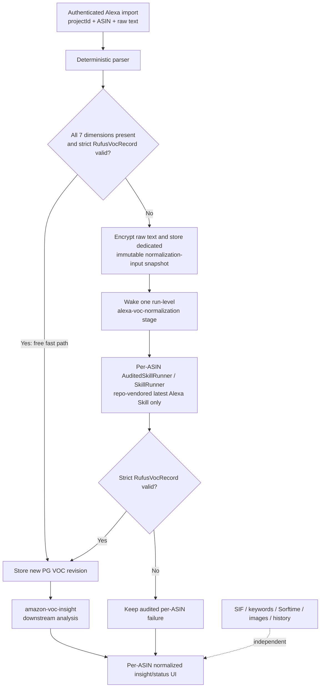

# Alexa for Shopping VOC 接入设计（仅设计，尚未实施）

> **状态：Design only。** 本文只定义后续实现边界，不表示代码、数据库迁移或运行环境已经完成变更。

## 目标与唯一 Skill 来源

Alexa for Shopping 导入结果需要先变成严格的七维 `RufusVocRecord`，再交给 `amazon-voc-insight` 做下游洞察、评分和产品建议。标准化阶段只允许使用业务本次提供的最新版源包：

`C:\Users\EDY\Desktop\alexa-for-shopping-voc\`

实现时把经过验收的内容版本化复制到 `skills-src/alexa-for-shopping-voc/`；正式运行时只从仓库 Skill registry 加载，不依赖桌面目录。旧 `voc-listing-optimizer` 明确排除，不得作为兼容回退、备用提示词或历史默认值继续执行。Skill 的内容哈希与版本必须在每次标准化执行时解析并固定到审计身份中。

`amazon-voc-insight` 是另一项下游分析 Skill，不等同于格式转换 Skill。canonical runtime 当前尚未把它注册为正式运行 Skill，因此实现范围必须包含：将业务批准版本纳入 `skills-src/amazon-voc-insight/`、补齐严格输入/输出合同并接到分析报告链路；不得把“本地 agent 可见”误写成“正式 runtime 已接通”。

## 核心决策

系统保留确定性 parser 作为免费快速路径，但只有当一次解析同时满足以下两个条件时才能直接入库：

1. 七个 VOC 维度全部存在，不允许缺维、空维或未知维度替代。
2. 完整结果通过严格 `RufusVocRecord` schema 校验，包括字段集合、类型、枚举、长度和嵌套证据结构。

任一条件不满足时，不得保存部分解析结果、静默补空值或把宽松对象伪装为成功；系统必须为相关 ASIN 排入新的异步 stage：`alexa-voc-normalization`。该 stage 复用现有 `AuditedSkillRunner` / `SkillRunner`，执行上述最新 Skill，并对模型输出再次执行严格 `RufusVocRecord` 校验。验证成功后，将规范化结果作为新的 PostgreSQL VOC revision 写入既有存储，再由 `amazon-voc-insight` 消费；验证失败则记录该 ASIN 的失败状态，不进入下游 VOC 分析。

该设计不新增业务表。为让新 stage 成为正式运行合同，实现必须同步补齐：

- `StageName` 中的 `alexa-voc-normalization` 定义；
- 对应 agent 定义、输入/输出合同和重试策略；
- orchestrator 的入队、恢复、按 ASIN 汇总与下游触发逻辑；
- PostgreSQL 与 SQLite 的 stage `CHECK`，以及 `data_snapshots.snapshot_kind` / `artifact_kind` 与一致性 trigger 迁移，保证生产和本地/测试数据库合同一致。

现有 `run_stages` 具有 `UNIQUE (run_id, stage)`，因此设计不是为每个 ASIN 新建一条 stage。每个分析 run 只创建一个 `alexa-voc-normalization` stage；该 stage 内针对每个 ASIN 的加密输入 snapshot 分别创建受审计执行。stage 表示本批处理器是否已跑完，ASIN 的真实结果则由对应 snapshot、`agent_runs` 与成功 revision 联合判定。

## 架构与数据流

确定性 parser 是零模型成本的优化，而不是宽松兼容层。它与 Skill 路径产出同一个严格合同和同一种 PostgreSQL revision；下游不得根据产出来源走两套业务逻辑。

## 导入身份与租户隔离

每次 import/capture 必须携带 `projectId`，服务端用认证主体校验项目权限，并确认 ASIN 属于该项目；不得信任未与认证身份绑定的裸 `projectId`，也不得在缺失时用最近项目、默认项目或 ASIN 反查结果代替。`projectId` 用于绑定当前 analysis run、加密输入 snapshot、异步 job、runner 审计和下游分析。

既有 `manual_alexa_voc_revisions` 的权威范围是 `organization + marketplace + ASIN`，本期不改变为 project 级存储。同一组织的不同项目可以复用完全相同的成功 revision，但每次读取都必须先验证项目权限和 ASIN 成员关系；pending/failure 与模型预算仍绑定各自项目/run，不得跨项目借用未完成执行。

## 原文安全边界

Alexa 原始文本是敏感输入：

- 静态存储必须加密；传输沿用现有受保护通道。加密实现复用现有 keyring 与 AES-256-GCM 核心，但使用独立的 `alexa-voc-normalization-input/v1` AAD（绑定 organization/project/run/snapshot/marketplace/ASIN/schema），不得伪造尚不存在的 manual revision identity 来调用现有 revision cipher。
- 日志、错误消息、trace、runner 审计摘要和成本记录不得包含原文，只允许记录哈希、长度、状态和脱敏错误分类。
- 普通业务 snapshot 不保存明文。规则失败时只允许创建专用、不可变的 normalization-input snapshot，其中保存经现有 cipher 加密的 envelope、原文哈希和最小路由元数据；不得保存明文，也不得进入常规导出。
- 用户粘贴时原文必然存在于本地 textarea 和受保护的导入请求中；服务端接受后不得在响应、轮询接口、折叠区、失败详情或调试数据中回显原文。页面后续只消费已验证记录、证据摘要和状态。
- 模型执行需要原文时，仅在授权 worker 内按需解密，调用结束后不得写入临时业务字段或普通缓存。

## 执行指纹、幂等与 revision

标准化缓存和幂等判断使用完整执行指纹，至少包含：

- 原始文本的加密前稳定哈希（不包含原文）；
- parser 名称与版本；
- 最新 Alexa Skill 的 `contentHash` 与显式版本；
- 严格 `RufusVocRecord` schema digest；
- 模型配置，包括 provider/model、关键推理参数及影响输出的 runner 配置。

只有完整指纹一致且已有成功 revision 时才允许复用。任何一项变化都创建新的执行并在成功后写入新的 PostgreSQL revision。失败或 pending 记录不可冒充缓存命中；并发相同指纹必须通过现有幂等/去重机制收敛到同一有效执行。revision 的 `contentHash` 纳入来源、parser/Skill、schema 与模型身份；Skill 路径通过 normalization-input snapshot ID 与 `agent_runs` 保存可追溯审计关系，不新增业务表或把可还原原文写进普通字段。

## 按 ASIN 状态与故障隔离

`alexa-voc-normalization` 的 UI 状态粒度是 `projectId + ASIN + normalization-input snapshot/content fingerprint`，由 snapshot、对应 `agent_runs` 和成功 revision 推导，每个 ASIN 独立处于 `pending`、`success` 或 `failure`：

- `pending`：已入队或正在执行，只让该 ASIN 的 VOC 卡片显示处理中。
- `success`：严格校验通过、PG revision 已提交，随后允许触发该 ASIN 的 `amazon-voc-insight`。
- `failure`：保留脱敏失败分类与可审计执行引用，支持按现有策略重试，不发布部分或旧结果为本次成功。

一个 run 只有一个 normalization stage；worker 在该 stage/job attempt 内逐个处理待处理 snapshot，并捕获单 ASIN 的模型或数据错误后继续。stage `succeeded` 只表示当前已排队输入均已得到终态，不表示所有 ASIN 都成功；单 ASIN 的 `failure` 必须继续由该 ASIN 的 `agent_run` 如实展示。只有租约、数据库或 worker 等系统级错误才让整个 stage 失败。

单个 ASIN 的 parser、runner、schema 或入库失败，绝不能阻塞 SIF、关键词、Sorftime、图片分析、项目历史、其他页面或同批次的其他 ASIN。页面不得使用全局 loading 或全局失败状态；每个 ASIN 的 VOC 区域独立显示 pending/success/failure，其他模块与其他 ASIN 可继续加载和操作。批次汇总只汇报各 ASIN 状态，不把部分失败升级成全项目阻塞。

## 错误处理与恢复

确定性 parser 不通过时属于异步 Skill 路径的正常分流，不应记录为最终失败。服务端先持久化专用加密输入 snapshot，再返回 accepted/pending；不得把仅存在于 HTTP 进程内存中的原文当作可恢复队列载荷。只有 Skill 执行、严格 schema 校验或 revision 提交在重试策略结束后仍失败，才将对应 ASIN 标记为 `failure`。错误数据必须脱敏，禁止把模型原始响应或 Alexa 原文写进日志和页面。

重试复用现有 runner/orchestrator 的超时、退避、并发和审计能力。恢复时重新计算并核对完整指纹；配置或 Skill 已变化则产生新执行，不能把旧失败直接改写成新版本成功。只有 PG revision 事务提交成功后才发送下游就绪事件，避免 `amazon-voc-insight` 读取半成品。

## 数据库与迁移

不新增 Alexa/VOC 业务表。规范化结果继续写入既有 PostgreSQL VOC revision 存储；异步输入复用既有 `data_snapshots` 保存专用加密 envelope，模型状态复用 `agent_runs`；本地开发和自动化测试继续使用对应 SQLite 结构。实现阶段需要新增迁移：将 `alexa-voc-normalization` 加入 stage `CHECK`；将 `alexa-voc-normalization-input` 加入 `data_snapshots.snapshot_kind` / `artifact_kind` 允许集合并更新一致性 trigger 与必要的局部唯一索引。若 SQLite 通过重建表实现 `CHECK` 变更，迁移必须保留已有行、索引和约束。

迁移只扩展 stage、snapshot/artifact 枚举约束及必要的现有 agent/orchestration 元数据，不借机建立新 canonical VOC 表、原文表、缓存表或跨模块队列平台。

## 测试与验收

### Parser 与 schema

- 完整七维且严格合法的 fixture 走免费快速路径，不调用 `SkillRunner`。
- 缺任一维、空维、额外未知字段、错误类型、非法枚举或证据结构不合法时，一律进入 `alexa-voc-normalization`。
- parser 与 Skill 的成功产物都必须通过同一严格 `RufusVocRecord` validator。
- Skill 输出校验失败不得写成功 revision，也不得触发 `amazon-voc-insight`。

### Skill 与执行身份

- 打包测试证明 `skills-src/alexa-for-shopping-voc/` 与业务提供源包的已批准内容一致；runtime 只加载仓库版本且旧 `voc-listing-optimizer` 不会被选择或回退。
- `amazon-voc-insight` 在 `skills-src` 中有经验证的 manifest、严格合同和正式 agent/report 接线；测试不得用 `.agents/skills` 的可见性冒充 runtime 注册成功。
- `AuditedSkillRunner` / `SkillRunner` 记录 Skill `contentHash`/version、schema digest、parser 版本和模型配置。
- 原文、parser、Skill、schema 或模型配置任一变化都会改变指纹；完全相同的成功指纹才复用 revision。
- 相同指纹并发入队只产生一个有效标准化结果，下游只被触发一次。

### 认证与隐私

- 缺失、伪造、越权或与认证上下文不一致的 `projectId` 在导入入口被拒绝。
- 跨项目使用相同 ASIN 与相同原文时，成功 revision 可在同组织内安全复用；job、预算、pending/failure 状态仍严格绑定各自项目/run，跨组织绝不复用。
- 原文在静态存储中为密文，并通过日志、trace、错误、普通业务 snapshot、服务端响应、轮询 payload 和常规导出泄漏扫描。
- worker 只在授权执行窗口内解密；失败路径同样不泄漏原文或模型原始响应。

### Stage、数据库与编排

- `StageName`、agent 定义和 orchestrator 均识别 `alexa-voc-normalization`。
- 同一 run 只有一个 normalization stage，但可关联多个按 ASIN 划分的加密输入 snapshot 与 `agent_runs`；其中一个模型失败后 worker 仍处理其余输入。
- PostgreSQL 与 SQLite 迁移前拒绝新 stage/snapshot kind，迁移后接受 `alexa-voc-normalization` 与 `alexa-voc-normalization-input` 且保留既有数据，回滚行为明确并经过验证。
- normalization input 的 AAD 与 snapshot identity 任一字段不一致时解密必须失败；测试证明不会使用 synthetic revision 绕过 revision cipher 身份校验。
- schema 验证成功但 PG revision 事务失败时不触发下游；提交成功后才让 `amazon-voc-insight` 消费该 revision。
- 不新增业务表的 schema diff 测试通过。

### 隔离与 UI

- 同批多 ASIN 中一个 pending、一个 success、一个 failure 时，各自卡片状态正确，成功 ASIN 可继续分析。
- 单 ASIN 失败不阻塞 SIF、关键词、Sorftime、图片、项目历史、其他页面或其他 ASIN。
- 页面不存在全局 loading 锁；失败详情脱敏，页面及网络 payload 均无原文。
- 失败或 pending 不以旧 revision 伪装本次成功，若展示历史结果必须明确标注其 revision 与过期状态。

## 非目标

本设计不负责：

- 修改或维护旧 `voc-listing-optimizer`，也不提供双 Skill 运行或回退；
- 让确定性 parser 接受不完整七维、宽松 schema 或自动臆造缺失内容；
- 在标准化 stage 内完成洞察、机会评分或产品定义，这些继续由 `amazon-voc-insight` 负责；
- 新建 Alexa/VOC 业务表、统一数据平台、知识图谱或新的通用队列系统；
- 展示 Alexa 原文、模型原始响应或把它们写入普通 snapshot；
- 全量迁移历史静态文件、回填所有旧执行或改变其他分析模块的业务合同；
- 用全局 loading、全项目失败或批次级阻塞简化按 ASIN 状态管理。

## 实施切片（后续工作）

1. 将两个已批准 Skill 版本化纳入 `skills-src`，补齐严格合同，扩展 `StageName`、agent/orchestrator、snapshot/artifact kind 与 PostgreSQL/SQLite 约束迁移。
2. 在认证 import 中贯穿 `projectId`，实现七维严格 parser 快路径，以及规则失败时专用加密 input snapshot 的持久化与 stage 唤醒。
3. 实现单 stage 内按 ASIN 执行的 `AuditedSkillRunner`、完整指纹、失败隔离、PG revision 提交和 `amazon-voc-insight` 下游接线。
4. 实现按 ASIN 的实时轮询/刷新 UI，并完成定向、迁移、幂等、安全、兄弟模块隔离与最终构建门禁。

以上切片均为计划，不属于本文档修改已完成的实现。
