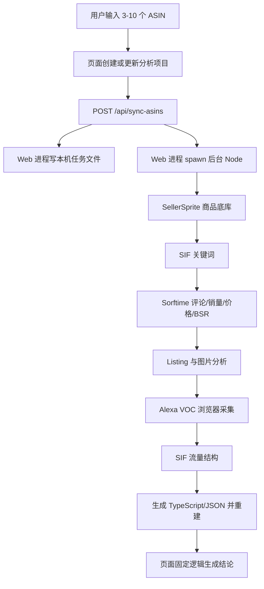
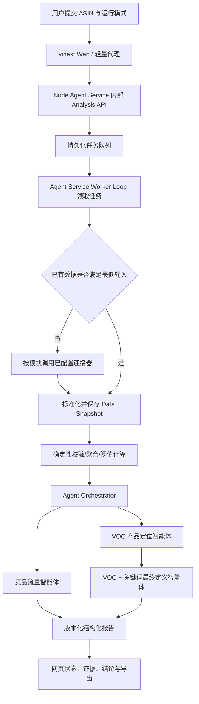
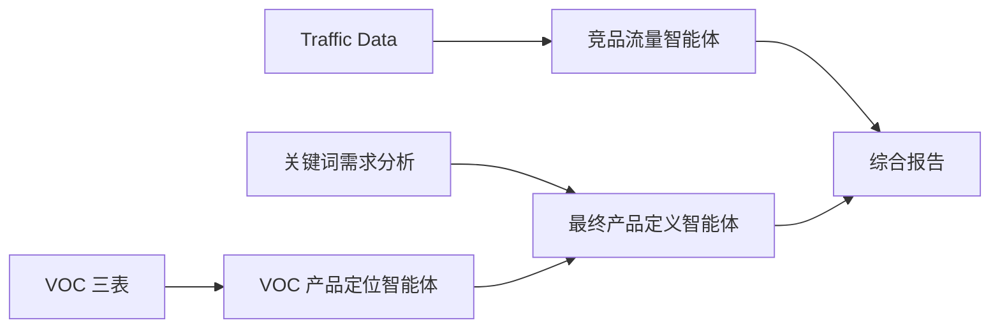

## Context

动机见 [proposal.md](proposal.md)。当前代码是一套 vinext/React 全栈应用，页面接收 3–10 个 ASIN 后创建分析项目，并调用 `/api/sync-asins`。该 API 通过 `app/lib/sync-server.ts` 在 Web 进程内写入 `data/sync-jobs`、派生 Node 后台进程，再由 `scripts/run-asin-sync-job.mjs` 串行调用商品底库、SIF、Sorftime、SellerSprite、Alexa/浏览器和构建脚本。采集脚本把结果转换成仓库内 TypeScript/JSON 数据，最后触发重建或热更新。

页面中的 VOC 定位和最终产品定义主要由固定 TypeScript 函数组装。仓库根目录的三个 ZIP 包含完整 Skill 规则与引用资料，但生产请求不会动态加载或执行这些 Skill。因此当前页面标注的 Skill 更接近“规则来源”，不是可独立部署的智能体。

主要约束：

- Cloudflare Worker/vinext 请求环境不能提供持久本机文件系统、PowerShell 或任意后台子进程。
- 第三方数据源分别依赖 API/MCP、登录会话、浏览器自动化或人工导入，并非所有部署环境都具备这些能力。
- 分析中存在大量可以确定计算的指标和阈值，不能交给模型自由估算。
- 用户需要本地先跑通，同时保留部署到普通服务器且完全脱离 Codex 的路径。
- 迁移期间不能一次性废弃现有页面和已经采集的数据。

## Current Business Flow

该流程在开发者 Windows 机器上可以成立，但它把 Web 生命周期、机器能力、采集凭据和分析发布绑在一起。截图中的 `operation not permitted` 属于这个边界冲突，而不是 ASIN 格式或页面展示本身的问题。

## Goals / Non-Goals

**Goals:**

- 建立可在本地和生产环境运行的同一套分析运行模型。
- 让三个 Skill 成为明确版本、明确输入输出且不依赖 Codex 的智能体。
- 让数据采集、确定性计算、模型判断和报告展示各自可测试、可替换。
- 允许先使用已有数据跑通最短闭环，再逐个接回外部数据连接器。
- 保存足够的来源与运行元数据，以便复现和审核业务结论。

**Non-Goals:**

- 首个纵向切片不追求一次接通全部 MCP、浏览器和第三方账号。
- 不把任意 Markdown Skill 当作可执行代码，也不允许运行时执行 Skill 附带的未知脚本。
- 不在本次变更中重新设计整套页面视觉或重写所有现有分析算法。
- 不宣称仅凭 VOC、关键词或流量数据即可自动批准立项。
- 不在首版拆成多个独立微服务；模块边界先在一个仓库中落实。

## Target Business Flow

### 用户可见阶段

1. **创建分析**：校验站点和 3–10 个 ASIN，创建项目与运行。
2. **检查数据**：逐 ASIN、逐模块计算 ready/missing/stale/blocked。
3. **补齐数据**：仅对缺失模块派发连接器任务；需要人工操作时明确暂停。
4. **标准化数据**：形成带来源、时间和转换版本的数据快照。
5. **运行分析**：确定性计算先运行，达到最低输入条件的智能体按依赖图执行。
6. **审核输出**：校验结构化结果、证据引用与强制数据边界。
7. **发布报告**：页面展示 complete/partial/stale/unavailable，并允许导出同一版本结果。

## Decisions

### 1. MVP 采用 vinext Web 加 Node Agent Service 两进程

两个进程保持同一仓库并共享经过明确导出的协议类型：

- **vinext Web（默认本地端口 3001）**：页面、登录界面、用户交互和到 Agent Service 的轻量 HTTP 代理；不打开 SQLite、不加载 Skill、不执行后台任务。
- **Node Agent Service（默认本地端口 3100）**：提供受认证的内部 Analysis API，拥有 SQLite/PostgreSQL、任务租约、Worker Loop、Skill Runtime、OpenAI 适配器和数据连接器。

MVP 中 Agent Service 的内部 API 和 Worker Loop 位于同一 Node 进程，以减少首版部署单元；任务本身仍持久化，不能依赖进程内队列。首个生产版本允许两个进程部署在同一台 Windows 或 Linux 服务器。任务量增加后，再把 Analysis API 与 Worker Loop 拆成独立进程并增加 Worker 实例，不改变 Web 对外协议和数据库模型。

**原因：** 当前 vinext 项目以 Cloudflare Worker 兼容环境为主要目标，不能把普通服务器的持久磁盘和进程生命周期当作默认能力。Node Agent Service 明确承载这些服务器职责，同时避免首版直接承担三进程或微服务的部署、网络和观测成本。

**备选方案：**

- 继续由 vinext Web 直接打开 SQLite、启动脚本：会重新引入运行时兼容问题，否决。
- 一开始拆为 vinext Web、Node Analysis API、Node Worker 三个进程：边界更强，但首版运维复杂度过高，暂缓。

### 2. 使用数据库租约实现首版持久队列

分析运行、阶段、尝试和任务均存入 SQL 数据库；Worker 通过带租约的原子领取机制处理任务，支持超时回收和有限重试。首版不强制引入 Redis 或专用消息队列。

**原因：** 任务量初期不大，数据库队列减少基础设施，同时满足页面刷新、进程重启和失败审计。领域存储通过接口隔离，本地使用开启 WAL 与忙等待配置的 SQLite，生产使用 PostgreSQL；两者使用同一数据模型、迁移与约束定义。正式上线前必须在 PostgreSQL 上通过并发领取、租约超时回收、进程重启恢复和重复请求幂等测试。

**备选方案：** 内存队列无法恢复；本机 JSON 文件不能跨实例；专用消息系统在首版收益不足。

### 3. Skill 使用可审查源目录，不在运行时直接执行 ZIP

三个 ZIP 作为原始交付包保留。迁移时将其内容展开到版本控制下的 Skill 源目录，每个 Skill 增加 manifest、输入模式、输出模式和测试样例。运行时只读取允许的 Markdown/引用资料和模式，不执行包内任意代码。

**原因：** 可直接代码审查、比较版本、做 CI 校验，并降低 ZIP 路径、动态代码和供应链风险。

### 3.1 第三方 MCP 独立于 Cursor 运行

现有 SIF、Sorftime 和 SellerSprite 客户端本身已经通过 HTTP/JSON-RPC 直接调用远程 MCP 地址；Cursor 仅被用作读取 `~/.cursor/mcp.json` 密钥的备用位置。迁移后删除该配置路径和相关提示，Worker 分别从 `SIF_MCP_SECRET`、`SORFTIME_MCP_KEY`、`SELLERSPRITE_SECRET_KEY` 或生产秘密管理服务读取凭据。

每个远程 MCP 被包装为独立连接器，统一提供配置检查、健康检查、超时、有限重试、限流处理、响应解析和错误脱敏。应用运行、部署和故障排查均不得要求安装或启动 Cursor。

### 4. Skill 与 Agent 分层

- **Skill**：业务知识、强制规则、分析步骤、数据边界和输出语义。
- **Agent Definition**：选择 Skill 版本、输入/输出模式、模型配置、工具白名单和重试策略。
- **Agent Run**：一次不可变的输入快照和输出记录。
- **Orchestrator**：只负责依赖、状态和数据传递，不自行生成业务结论。

这样同一 Skill 可以经过版本升级，而历史运行仍能指向原版本；未来也能在不改业务规格的情况下更换模型提供商。

### 5. 确定性核心与生成式外壳

以下内容由代码计算：数据完整性、分母口径、流量加总、TOP1/TOP3、HHI、同义词去重后的聚合、阈值分档、P0–P3 规则和证据索引。模型只消费这些结构化事实，负责主题合并建议、解释、冲突判断、产品语言和行动建议。

输出先经过 JSON 模式校验，再经过业务不变量校验。模型不得覆盖代码计算值；冲突时结果失败或降级为人工审核。

迁移期间旧 TypeScript 结论与新智能体结果在同一输入快照上并行生成，但正式页面同一模块只展示功能开关选中的一个主结果，避免用户面对两个相互竞争的答案。对照记录只进入开发评测和管理员诊断。发现必填事实、P0/P1、数据边界或证据引用回归时立即切回旧结果。

旧实现只有在代表性样例集通过、生产灰度稳定且回退窗口结束后才可删除其纯文字模板；数据解析、数值聚合、阈值、不变量和证据索引继续作为确定性核心保留。

### 6. 三智能体使用依赖图而非全串行

流量智能体与 VOC 定位智能体互不依赖，可分别运行。最终产品定义依赖 VOC 定位和关键词分析；流量结论可以进入综合报告，但不作为最终产品定义的硬依赖，避免流量连接器故障阻塞全部产品定义。

用户一次启动分析后，编排器自动运行所有依赖已满足的智能体，同时保留按智能体单独重试和重跑的能力。单个智能体失败不得删除其他成功结果；前序输入或报告版本变化时，依赖它的后续报告标记为 `stale`，由用户触发或确认重新生成。

### 7. 先实现已有数据纵向切片

首个可验收切片使用仓库已有数据：创建运行 → 形成快照 → 执行确定性预处理 → 运行 VOC 定位智能体 → 保存结构化报告 → 网页展示。之后再接流量智能体、最终产品定义和实时采集。

**原因：** 该切片可以独立证明 Skill 在无 Codex 环境中被真实加载并执行，也能把模型问题与外部采集/登录问题分开定位。

MVP 的 Amazon/Alexa VOC 只读取已有数据，并提供网页粘贴或文件导入；缺失时阶段进入 `waiting-input`，不得在 Web 进程尝试启动本机 Chrome。后续阶段再实现独立 Playwright Browser Worker，使用管理员配置的公司账号和加密会话存储，并在上线前完成数据源条款与公司合规审查。Browser Worker 与普通分析 Worker 隔离，登录失效必须转为明确的人工重新认证操作。

### 8. 模型通过提供商适配器调用

领域层只依赖“结构化生成”接口。MVP 的第一个适配器使用 OpenAI Responses API，并用结构化输出约束智能体结果；运行记录必须保存提供商、模型、关键参数和响应标识。模型名称通过服务端配置选择，不硬编码进 Skill。API Key 只来自服务端环境或秘密管理服务。

该 API 适配器属于部署后应用的一部分，与 Codex 开发会话无关。后续本地模型或其他提供商通过新适配器接入，不改变智能体业务规格；MVP 不同时实现第二个模型提供商。

### 9. 报告是不可变版本，不直接覆盖

每次成功尝试产生新的报告版本，关联运行、数据快照、Skill 版本和模型元数据。报告通过校验后直接作为 `analysis-result` 向团队展示，并明确标记 AI 生成、数据截止时间和适用边界。重试不会静默覆盖先前结论；新版本与旧版本均可追溯。

MVP 不实现报告审批状态机、审核角色或正式报告编号。现有“立项前确认清单”继续承担人工确认与会签材料的职责。任何报告中的“建议立项”仍然只是分析建议，不代表公司立项审批已完成；成本、利润、专利、合规和供应链仍属于独立决策门槛。正式报告审批工作流列为后续阶段候选。

### 10. 模型调用具有硬预算与有限重试

每个智能体默认执行一次；仅对暂时性提供商错误执行最多两次指数退避重试，对可修复的结构化输出错误最多执行一次修复重试。每次智能体调用、每个 AnalysisRun 和每个组织日历日都具有管理员配置的 Token/费用上限；任何层级达到上限后停止创建新模型请求，并将受影响阶段标记为 `budget-exceeded`。

系统记录模型、输入/输出 Token、延迟、重试原因和依据官方计价配置计算的费用估算。普通成员不能覆盖模型或预算配置。智能体不能自行递归启动智能体或形成无界工具循环；所有允许调用均由编排器依据静态依赖图创建。

### 11. MVP 不引入 LangChain 或 LangGraph

MVP 使用项目自有的 TypeScript `AnalysisOrchestrator`、显式静态依赖图、数据库 RunStage/JobAttempt 状态和 OpenAI 官方 SDK。三个智能体不互相对话，不由模型动态选择连接器，不执行循环反思；数据采集、确定性计算和后续节点选择都由代码控制。因此引入 LangChain Agent Loop 或 LangGraph Checkpoint 会与现有业务状态和持久任务形成重复抽象。

编排器通过稳定接口隔离，只有在出现大量动态分支、循环批判/修订、运行中人工修改状态、多智能体多轮对话或自研编排维护成本明显更高时，才重新评估 LangGraph。技术学习实验必须放在独立 `spike/langgraph-orchestration` 分支，并使用同一评测集比较后再决定，不作为 MVP 依赖。

## Data Model

| 实体 | 关键职责 |
|---|---|
| AnalysisProject | 站点、ASIN 集合、名称和当前运行 |
| AnalysisRun | 启动模式、总体状态、数据截止时间和幂等键 |
| RunStage | 阶段状态、依赖、进度、错误和当前尝试 |
| JobAttempt | Worker 租约、重试次数、开始结束时间和标准错误 |
| DataSnapshot | 某次运行使用的规范化数据及来源清单 |
| SkillVersion | Skill 内容哈希、语义版本、引用资料和模式版本 |
| AgentRun | Skill、模型、输入摘要、输出和校验状态 |
| AnalysisReport | 报告类型、模式版本、状态、证据索引和发布版本 |

## Runtime Boundaries

| 模块 | 允许 | 禁止 |
|---|---|---|
| Browser | 提交任务、轮询/订阅状态、展示报告 | 接收第三方秘密、直接执行 Skill |
| vinext Web | 页面、登录交互、请求校验、代理内部 API、展示结果 | 打开 SQLite、加载 Skill、派生后台进程、依赖本机持久文件 |
| Node Agent Service API | 服务端授权、创建任务、读取结果、管理会话 | 在 HTTP 请求中同步完成长时间分析 |
| Agent Service Worker Loop | 领取持久任务、调用连接器、确定性计算、模型调用、持久化 | 把秘密写入日志或提示词、依赖进程内任务队列 |
| Connector | 访问单一外部数据源、标准化原始响应 | 直接生成最终业务结论 |
| Agent Runtime | 加载受信 Skill、构造结构化请求、校验输出 | 调用未声明工具、依赖 Codex 对话 |

## Error Model

错误至少分为：validation、configuration、authentication、rate-limit、upstream-temporary、upstream-permanent、data-quality、model-output、infrastructure 和 cancelled。只有明确的暂时性错误自动重试；认证、配置和数据质量错误进入 waiting-input 或 failed，并提供用户下一步动作。

## Evaluation Gate

智能体替换旧规则前建立版本化评测集，首批至少覆盖：滑板车完整数据、灯具完整数据、VOC/关键词缺失、第三方口径冲突和安全问题必须提升 P0。每个样例固定输入快照、确定性预期、不允许出现的结论和人工评分基线。

自动门槛包括：输出模式通过、确定性数值一致、不虚构数据、安全问题不降级、数据边界完整、重要结论具备证据、缺失项明确标记、失败回退有效和历史版本不覆盖。人工门槛评估准确性、解释质量、行动可执行性、风险完整性、无证据推断和业务可读性。自动门槛全部通过且人工评分达到发布阈值后，模块功能开关才可扩大灰度。

## Security and Observability

- 连接器凭据、模型 API Key 和浏览器会话仅存在于 Worker 的服务端秘密环境。
- MVP 采用管理员统一配置的公司服务账号凭据；普通业务用户只能发起分析和查看授权项目，不能读取、提交或覆盖第三方密钥。
- 凭据配置、更新、吊销与轮换属于管理员操作，并留下不包含秘密值的审计记录；不同连接器使用独立秘密，避免共享一个万能凭据。
- 日志使用 runId、stageId、attemptId 关联，敏感头和请求体字段在写入前清理。
- 保存 Skill 内容哈希与数据快照引用；默认不在普通日志保存完整模型提示词和原始客户数据。
- 记录任务耗时、重试次数、模型用量、模式校验失败和连接器成功率。
- 生产写操作必须关联用户或服务身份；项目数据按部署的租户边界隔离。
- 模型请求通过按智能体声明的传输对象白名单构造，只包含当前分析必需的 ASIN、规范化指标、关键词、VOC 主题、必要匿名摘录、确定性结果、Skill 内容和输出模式。第三方密钥、Amazon Cookie、密码、会话、成员身份信息、完整请求头、无关项目和数据库导出禁止进入模型请求。
- 普通日志默认不保存完整提示词、完整模型响应或评论全文，只记录模式版本、字段/记录数量、内容摘要哈希、响应标识、Token、耗时和错误分类；受控诊断数据必须经过脱敏并具有访问与保留限制。

### Internal organization access model

MVP 面向单个公司组织，不提供公开注册、计费和多租户自助开通。用户分为 admin 与 member；团队项目默认在组织内共享，但每个项目、运行和管理操作都记录发起身份。身份验证通过独立适配层接入，业务授权只依赖内部用户、组织和角色记录，不依赖 Codex 会话。

首个管理员通过一次性部署命令初始化，后续账号只能由管理员创建或邀请。密码使用适合密码存储的内存强化哈希并带独立盐值；会话使用不可预测的服务端会话标识，浏览器仅保存 `HttpOnly`、`Secure`、`SameSite` Cookie，数据库只保存会话令牌哈希。账号停用、密码重置和管理员强制退出必须立即撤销相关会话。登录接口按账号和来源实施限流；MVP 的忘记密码由管理员发起重置，不引入邮件发送系统。

## Risks / Trade-offs

- [第三方数据源仍可能依赖脆弱的浏览器流程] → 把每个来源封装为独立连接器，提供人工导入和 waiting-input，而不是伪装全自动。
- [模型输出即使符合 JSON 也可能业务错误] → 确定性计算优先、证据索引、业务不变量校验和可回放评测集。
- [SQLite 与 PostgreSQL 行为差异] → 限制使用共有 SQL 能力，并在 CI 中对生产数据库方言运行迁移和关键并发测试。
- [数据库轮询队列吞吐有限] → 通过租约、索引和批量领取满足首版；达到明确吞吐阈值后再迁移专用队列。
- [Skill 升级造成报告漂移] → Skill 版本不可变，历史运行固定版本，新版本通过样例和回归评测后发布。
- [迁移期间存在新旧两套结论] → 页面明确标记报告来源，按模块切换并保留回退开关。

## Migration Plan

1. 固化现状契约与样例数据，停止把 ZIP 仅作为不可审查附件使用。
2. 展开三个 Skill 到版本化源目录，增加 manifest、输入/输出模式和静态校验测试。
3. 建立运行、阶段、快照、Skill 版本、AgentRun 和报告存储。
4. 实现本地 Worker、数据库任务租约和模型适配器。
5. 用已有数据完成 VOC 定位纵向切片，并与现有 TypeScript 结果做并行对照，不立即替换页面。
6. 接入流量智能体和最终产品定义智能体，建立回归样例与人工审核清单。
7. 将页面按模块切换到新报告 API；异常时可回退现有固定逻辑。
8. 把现有采集脚本逐个包成连接器，取消 Web 进程的文件写入和 `spawn`。
9. 在生产环境配置共享数据库、独立 Worker、秘密和监控后进行灰度发布。

回滚时停止新 Worker 领取任务，保留数据库记录和新报告，页面通过功能开关恢复读取旧数据模块；不得删除已生成的运行与审计记录。

## Development Delivery Workflow

`main` 作为受保护集成目标，不直接进行功能开发。当前 OpenSpec 与总体集成位于 `feature/agent-runtime-mvp`；每个可独立审查的 OpenSpec 实施单元从该集成分支创建独立 Git 分支和 worktree，由单独 Codex 编码窗口领取。

编码窗口只修改分配范围，按测试优先完成并提交原子 commit，返回变更摘要、测试命令与结果。本审核窗口检查规格符合性、代码质量、测试和工作树范围后，才将任务分支合并回 `feature/agent-runtime-mvp`。全部纵向切片通过本地、构建、回归和安全检查后，再将集成分支合并到 `main`。

真实仓库必须先以 `C:\Users\EDY\Amazon-Product-Opportunity-Insights` 注册为 Codex 项目，编码任务使用独立 worktree；不得让多个窗口共用同一工作目录。上下文多次压缩或接近上限时，先形成包含分支、commit、测试、未决问题和下一任务的交接摘要，再创建后续编码窗口。已有 `package-lock.json` 改动必须单独核查，不得混入无关功能提交。
