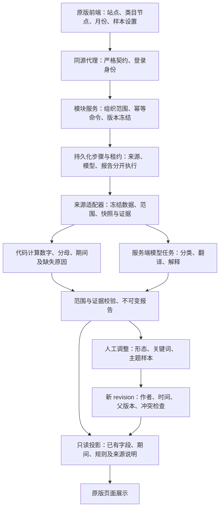

# 四模块补齐与统一验收

> 2026-09-17 追加问题核查见 `followup-verification.md`。本文件保留上一轮记录；其中窄屏点击限制和过时接口清单测试已在追加修复中处理。

日期：2026-09-16。工作树：`integrate-xydc-variant-20260905`。对应 change：`enable-market-backend-evidence-flow`。

本轮遵循“先完成，再统一审核”：保留原版结果区布局，将已有冻结数据能够支持的缺口补齐，并把当前计算口径放入页面折叠说明。正式服务未发布、未重启；本轮没有真实供应商或模型外呼。

## 实际执行架构

Cursor 不参与正式执行。采集与模型凭据来自正式服务配置；数值统计由代码完成；模型只处理获准的语义任务，输出经过结构与证据校验。报告读取不重新调用来源或模型。

## 完成内容与审核方法

| 模块 | 本轮结果 | 运营审核动作与预期 |
|---|---|---|
| 市场总览 | v5 完整流程入口及无模型恢复沿用首个切片；增加本报告规则详情，显示保存的版本、范围、公式及证据引用 | 打开已保存报告，展开“本报告的分析规则”；核对月份与公式。展开/收起、历史恢复不得创建任务；未知公式明确未识别 |
| 商品形态及价格带 | 展示已保存的收入、评分、卖家、上架日期；独立期间投影补齐近3/6个月、前两年及研究窗口，按形态、价格带、品牌和上架年份分组 | 核对标题/字段来源；选择历史 revision；未保存完整周期显示不可用。已知零与未知分开。链接占比包含全部选中链接，销量占比使用固定共同可比集合 |
| 类目关键词洞察 | 评分详情新增每簇原词输入核对，区分已保存证据、月份/币种不明及聚合规则缺失 | 展开评分依据，确认增长使用百分数；ABA 零值有来源；USD 来源页竞价与未知币种的月度竞价分开；不完整 PVS 保持待验证 |
| 类目买家评论见解 | 冻结样本标题、供应商排名、摘要与来源；排除/恢复原样本生成不可变 revision，从完整事实重算并保留旧映射 | 排除1个样本、全排除、恢复原样本；核对计数、空数据状态、操作者及版本。历史只读；多人并发不得覆盖；操作不重新采集或调用模型 |

三个模块的历史创建命令在模型配置变化或丢失后仍能重放；同键但不同研究、模块或公开参数会拒绝。关键词四入口和三个主题样本入口已进入公共代理契约，历史 ID 支持编码路径并保留严格验证。

## 验证证据

所有路径相对于本工作树。数据库使用独立临时 PostgreSQL；来源、模型使用合成实现。

| 覆盖 | 结果与日志 |
|---|---|
| 总览与三模块命令重放、配置变动、并发、跨模块冲突及组织隔离 | 13/13，`.superpowers/sdd/market-completion-replay-final.log` |
| 新增字段与期间规则、展示、模块边界与公共历史路径组合 | 26/26，`.superpowers/sdd/market-completion-unified-unit.log` |
| 总览实际浏览器展开规则、URL 恢复、只读和移动布局 | 1/1，`.superpowers/sdd/market-completion-overview-browser.log` |
| 形态规则、字段、页面与旧目录兼容组合 | 62/62，`.superpowers/sdd/market-completion-validation/shape-unit-ui.log` |
| 形态公开字段与2/8商品自动综合恢复 | 6/6，`.superpowers/sdd/market-completion-validation/shape-postgres-runtime.log`；8商品覆盖12窗口、4次归并 |
| 关键词真实认证服务与 Next 代理四入口 | 2/2，`.superpowers/sdd/market-completion-validation/keyword-public-proxy.log`；包括两种编码历史 ID、401/400/404与零额外外呼 |
| 关键词输入核对实际浏览器 | 1/1，`.superpowers/sdd/market-completion-keyword-browser.log`；已知零、来源路径、版本、移动布局与零分析请求 |
| 形态真实样式与合成字段视觉验证 | 1/1，`.superpowers/sdd/market-completion-validation/shape-styled-visual.log`；桌面与390px无整页横向溢出，表格内部滚动 |
| 主题纯规则、实际浏览器与原版展示回归 | 14/14，`.superpowers/sdd/market-completion-validation/theme-pure-browser.log`；包括2001组、长文本预算、样本排除/恢复、历史只读和迟到响应 |
| 主题原生 PostgreSQL、认证服务及真实同源代理 | 5/5，`.superpowers/sdd/market-completion-validation/theme-postgres-proxy.log`；包含新建/读取、样本修订、幂等、并发、鉴权与零额外外呼 |
| 主题多轮 v2 运行、修订与历史兼容 | 11/11，`.superpowers/sdd/market-completion-validation/theme-v2-runtime.log`；完整/部分 v2、排除恢复、取消后已接受命令重放、重试后旧 revision 不变 |
| 主题最终 effect 依赖调整后的浏览器回归 | 2/2，`.superpowers/sdd/market-completion-validation/theme-browser-final.log`；定向无错误/警告 ESLint 见 `theme-eslint.log` |
| 独立审查发现的增长显示及历史路径回归 | 10/10，`.superpowers/sdd/market-completion-review-fixes-green.log` |
| 主任务改动定向 ESLint | 通过，`.superpowers/sdd/market-completion-unified-lint.log` |
| 全仓类型检查 | 通过，`.superpowers/sdd/market-completion-unified-typecheck.log` |
| 本轮既有文件定向 diff-check | 通过，`.superpowers/sdd/market-completion-scoped-diff-check.log`；不把共享树其他文件的既有格式问题算作本轮通过 |
| OpenSpec 严格校验 | 通过，`.superpowers/sdd/market-completion-unified-openspec.log` |

以上组合有重叠，不相加为独立测试总数。

独立复审记录：`.superpowers/sdd/market-completion-validation/review.md`。范围内无剩余 P1/P2。复审实际复现并关闭三项问题：增长率单位混用；合法大主题结果超出代理响应限制；预算省略的负面主题被误显示为不存在。评论公开投影按每份160,000字节预算提供预览，元数据截断明确标识，历史只返回轻量索引；完整事实、总计和分母保留。20条长元数据、1000条历史及两份最大预算结果的组合小于900KB，没有放宽代理原有1MB限制。

形态视觉截图采用**合成数据**并装载生产全局样式：`test-results/market-completion-visual/shape/products-desktop.png`、`source-metadata-desktop.png`、`mobile.png`。旧 `market-shape-page` 交互测试截图未加载完整样式，不能作为视觉审核图。主任务已目视核对新版商品表和移动端来源字段截图。

移动端保留原版宽表与固定身份列；最右侧来源详情的鼠标点击区域可能被固定列遮挡，测试使用键盘展开。因此这里只确认页面无横向溢出及字段展示，不宣称移动端所有宽表交互已完整验收。

## 需要明确的边界

- 完整 PVS 仍缺正式供需比、SPR、关键词到商品价格映射，以及确认的币种/月份/簇级 ABA 聚合；本轮完成的是输入核对与可追溯说明，没有用原版固定50分占位伪造完整评分。
- 商品图片、成本/毛利、退货率和未保存历史月份没有被补造。评论数据仍是 Customers Say 聚合摘要，不是去重后的逐条评论。
- 主题样本调整继承原报告的主题归并；它重新计算保留样本的数字，不宣称重新运行模型。全量事实与公开展示预览分开，展示限制不得改变统计分母。
- 未宣称全仓测试全绿：`tests/agent/contracts.test.ts` 的“complete declared HTTP surface”固定列表在本轮前已缺少多个正式接口。本轮运行该文件与展示边界时为21通过、1失败（`.superpowers/sdd/market-completion-contract-boundary.log`）；新市场路径单独及真实代理验证已覆盖。其余模块的列表维护没有借本次修改扩大范围。
- 首个切片记录中的“前端251文件不变、无迁移”是历史状态。本轮有明确前端字段/规则接线，并新增 `0053_market_theme_selection_revisions.sql`，正式发布需执行已有迁移及任务空闲检查流程。
- 本地合成测试证明行为与边界，不替代真实供应商完备性、模型质量和业务验收。当前交付是本地待审核版本，线上地址不会因本轮本地修改自动变化。
