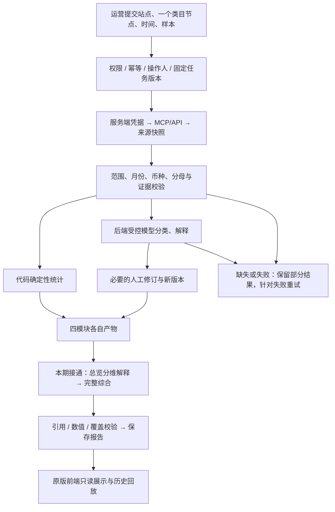

## Context

Approved source: `.superpowers/reviews/market-backend-flow-20260916/review-notes.md` and its diagram. See proposal.md for motivation. `MarketModuleService.startOverview` currently freezes v3 and expanded catalog; runtime already implements v5 with complete table catalog and a separate `overviewSynthesis*` identity. The public HTTP shape and frontend already understand persisted synthesis reports. The no-model fallback worker currently admits only overview v1-v3 and must be checked alongside the new entrypoint.

## Goals / Non-Goals

**Goals:** deliver the approved first executable slice (overview complete synthesis), exercise it from the public service/HTTP entry, and formalize the whole four-module roadmap and operator rule inventory. Persisted source/semantic identities remain strict. Verify failure and unavailable-model behavior locally with fake connectors and fake model transport, using isolated PostgreSQL test containers.

**Non-Goals:** restore old placeholder scores, choose new product/keyword thresholds, add cross-module synthesis, rewrite the frontend layout, migrate historical tasks, implement missing supplier fields without confirmed semantics, or modify the independent collection-reliability work. Small additive controls and labels required to expose a frozen saved parameter are allowed; they must not move business calculations into the client. Additive fields in existing tables and collapsible rule explanations are included by the continuation below.

## Decisions

1. New overview commands select existing v5 and the existing complete table catalog (`MARKET_OVERVIEW_TABLE_CATALOG_VERSION`). Use a dedicated optional `overviewSynthesisModelIdentity` dependency supplied from the current runtime. Absence means null model/prompt/configuration, never silently substituting the legacy identity. Alternatives rejected: upgrade old runs in-place (breaks replay), route v5 through generic identity (fails lineage), duplicate synthesis code (unnecessary divergence).
2. Command replay must resolve the existing organization-scoped idempotency record before recomputing runtime versions. Verify original study, overview kind and public parameters. Keep the repository's atomic creation and conflict handling; on concurrent identical submissions return the existing matching command, not a second analysis. Do not broaden idempotency behavior for unrelated modules.
3. Keep source-only execution as an explicit runtime path. Admit complete overview versions for rules, semantic-window preparation and numeric report handlers. Existing unavailable-model window planning must save a terminal partial report and never enqueue synthesis-only work it cannot execute. Exercise existing partially queued v5 tasks as well as new no-model runs. For work prepared before configuration removal, a scoped failure-only model consumer closes v4/v5 overview model attempts with an explicit governance reason, retaining audit protection. Non-model preparations requiring semantics also fail explicitly; a final report whose model output is already saved is routed to its pure synthesis report handler and can still complete. Configured consumers and this fallback are mutually exclusive; both start and shutdown paths are tested.
4. Keep model calculations evidence-bound. The existing v5 planner and report validators provide bounded reduction, references and failure recovery. Extend tests at the entry boundary rather than introducing another planner. Invalid outputs retain numeric artifacts, and successful sibling steps are not recollected on retry.
5. Record four-module capability gaps in `docs/market-research/backend-rule-inventory.md`, suitable for operator review. Include original-versus-current rule differences and exact prerequisites for later changes. The user-facing rule-page UI remains a subsequent presentation task; do not disguise a document as a deployed screen.

6. Keep overview request dimensions separate. `headTopN` remains the basic/concentration head selector (5/10/20); `sampleSize` is an optional new-run parameter for distribution samples (50/100/200, default 100 in the UI). Product, brand and seller concentration continue to use the original fixed Top100. The parameter is part of new command intent, saved run parameters, lookup identity, source-step hashes and upstream requests. Legacy runs without the field replay their original step input and are not rewritten.

## Risks / Trade-offs

- [New entry triggers additional model work] → follow existing runtime admission/budgets; local validation uses only fakes, no production test jobs or automatic historical reanalysis.
- [Deployment/config drift breaks repeat POST] → replay by frozen command identity and check client intent separately from runtime versions.
- [No-model worker does not recognize new flow] → shared production worker construction and behavioral source-only tests; partial results cannot stay queued indefinitely.
- [Reference is incomplete] → list missing artifacts and unverified rules; do not invent Cursor prompt equivalence.
- [Shared dirty worktree / another collection change] → capture file baselines, keep edits to entry/wiring/tests/docs, review the per-turn diff instead of claiming ownership of whole branch.

## Migration Plan

The initial overview slice has no database migration. The continuation adds an independent theme-selection revision table through a new migration, without rewriting existing tasks/reports. Validate new entry, legacy replay, no-model flow, invalid synthesis and targeted retries before publication. Production release remains a separate verification step using the existing idle gate; this task must not silently terminate active tasks. If publication is later rolled back, preserve already saved v5 artifacts and use a runtime that can read and handle their existing version.

## Continuation approved for unified review

The user's subsequent instruction is to complete remaining work before review. Extend the current change rather than declaring the first slice to be the whole system. Audit the remaining three modules against the original reference and saved inputs, then implement evidence-supported completion and operator-readable rules. Missing supplier inputs retain explicit limitations; unsupported thresholds are not selected merely to fill a dashboard.

### 2026-10-06 original-parity continuation

The completed local parity fixes are tracked in task section 10. They include public evidence visibility, shape pool control wording, Sorftime ranking order, full-set theme evidence deduplication, keyword source/reference volume separation, manual keyword dimensions, original matching/trend interaction, and saved overview `headTopN` chart limits. The new overview `sampleSize` parameter follows decision 6 and is backward-compatible with runs whose frozen params omit it. T10 translation, O11–O13 explanation/detail/drilldown work, business-output gaps BG-01–BG-03, and real browser acceptance remain open; no archive or publication is implied by local green tests.

First shared completion: apply frozen-command replay to shape-price, keywords and customer-themes. Compare canonical public parameters, study and module before resolving the current model or validating a time-sensitive new collection window. Organization and active-user checks remain mandatory. Concurrent creation conflicts re-read and return only the matching committed command. This preserves existing paid work across configuration changes and response loss. New commands still follow current configuration and collection admission policies.

Overview operator rules use a collapsed disclosure beside existing source/version details. Render the saved scope, cutoff, rule/planner versions, analysis scope statement and per-metric formula references. Explain only recognized formula versions (returned row, within-response group share, reported-sample month change); unknown versions are explicitly undocumented rather than inheriting current formulas. No client calculations or external requests are introduced. Other modules expose their corresponding versioned projections in their original tables and disclosures.

## Keyword score input audit projection (2026-09-16)

Add an independent `market-keyword-score-input-audit/v1` read projection, bound to the immutable factsId, reportId, referenceMonth and scoring ruleVersion. It takes source-verified frozen facts plus the existing rule report; it never regroups members, recalculates scores, changes calendar growth, modifies old hashes or initiates collection. Public run and manual-revision responses may include `scoreInputAudit` as a sibling. Old responses without the sibling remain readable.

For each existing cluster, expose the saved member references and field-level collection, currency, window and aggregation blockers. Keep undated USD page recommended bids separate from monthly trend bids with unknown currency; neither is actual CPC. Keep original-member ABA click and conversion shares separate, including real zero, and retain source paths and snapshot references. No cluster ABA aggregation or missing PVS component is fabricated. Supply-demand ratio, SPR and mapped product prices explicitly state missing inputs; provenance details do not pretend to establish a new provider contract.

Show these diagnostics inside the existing scoring details and version disclosure. Explain the current version's mid-rank and S1-S5/PVS formulas without introducing new thresholds or changing existing scores. Historical facts and reports stay unchanged. Validate audit/report/facts bindings at public browser boundaries, and preserve usable old reports when the optional audit is absent. Seasonality projection is outside this slice.

The ZIP business-output projection is a sibling of the preserved W1–W5/PVS report, not a replacement for it. It emits the fixed 14 items required by the ZIP business document in a stable order. Each item has `ready` or `pending` status, a conclusion, and either saved keyword-fact references or explicit missing evidence such as VOC, price, competition, profit, supply, or compliance data. The projection never upgrades the original PVS estimate into a formal opportunity grade and never reads a shape report to fill a gap. The existing keyword page renders all 14 items and exposes pending reasons to the operator.

## Shape completion: frozen metadata and period projections

The approved bounded shape slice reuses immutable product-month payloads and saved shape catalogs. `readMarketShapeRun` shall publish a whitelist of already-normalized revenue, rating, rating count, seller name, seller type and listing date, with source/snapshot/path provenance. Revenue stays a reference-month source observation, never price multiplied by units; unavailable or invalid fields stay null. Listing dates use strict calendar validation and reference-month cutoff. No image, cost, gross margin, return-rate or seller-type translation is inferred.

Saved revisions gain a separate `market-shape-period-projection/v1` read projection bound to `basisCatalogId`. It does not change persisted catalog bytes, catalog hashes, source normalization, semantic input or model identity. It contains trailing 3/6 calendar months, the two preceding calendar years, and the original study window. Only periods fully contained in the saved study window can produce numeric statistics. All periods retain the original entire-study complete-common-members cohort; a product missing any required saved month remains excluded across periods. Empty cohorts return null units, observed zero remains zero, and zero denominators yield null shares. Missing-window and no-comparable-member reasons remain explicit.

For each period the backend computes product totals, shape and shape-price-band totals, brand and brand-price-band totals, and listing-year totals from saved structure metadata. Unknown brand/year remains its own group; no listing-age bucket is relabeled as a year. Year-group sales-share denominators cover all selected comparable units, including unknown-year members; link-share denominators count all selected links including non-comparable links. The existing brand-price-band share uses all comparable members of that band; shape-price-band share uses its shape. Monthly efficiency is total units divided by comparable links and requested period months. Original columns consume these server values without new layout or client business calculations. History outside saved scope is not collected by reading a report.

Validation: source-field public HTTP projection, invalid/missing/zero fields, price-independent revenue, complete/partial periods, fixed cohorts, year boundaries, unknown metadata, denominator differences, manual exclusions, source/catalog immutability, legacy shape catalog replay, organizational isolation, and read-only call counts. Existing automatic shape window/synthesis/restart tests must remain green. Model identity tests assert current multi-market shared schemas and shape/overview isolation rather than replacing an obsolete US-only golden hash with another opaque hash.

## Customer theme selection completion (2026-09-16)

Keep saved theme report v1/v2 outputs, hashes and model bindings unchanged. Add a separately versioned, immutable selection revision anchored to a verified saved report attempt/hash. Read title, provider ranking and customer_say only from that report's frozen product selection and source evidence. Preserve provider row order and unverified BSR semantics; missing images remain null without enrichment calls.

The revision owns the full verified base artifact and its reconciliation history, frozen sample metadata, exclusion set, author, timestamp, optimistic parent and deterministic derived result. Exclusions are a subset of the original report's selected ASINs. Restore uses the original set; no replacement ASIN, source refresh or semantic rerun is permitted. Reuse accepted base mappings explicitly, filter complete ASIN/theme facts before aggregation, retain unknown/unavailable/reconciliation limitations, and allow an empty selection with null totals. Historical reads replay stored facts without resolving newer attempts. New APIs and UI show the base/revision identity and preserve original table layout.

Use organization-scoped transactions, active-user checks, a run lock, expected parent comparison and actor-bound idempotent commands. Same-key replay precedes current-state checks. Immutable database rows hold request/facts/result hashes and reject update/delete. Tests cover complete-artifact recomputation, missing metadata, all exclusions/restoration, concurrent edits, key conflicts, cross-organization access, old report hashes, browser stale responses and zero provider/model calls or execution-step creation.

## Follow-up usability and boundary audit (2026-09-17)

Keep this audit bounded to the existing four modules. First reproduce practical failures with frozen or synthetic inputs, record cause and impact, then patch and regression-test confirmed behavior. On viewports up to 640px the shape table's 240px sticky product column must scroll normally so it cannot intercept evidence controls; the selection checkbox may remain sticky and desktop identity columns retain their behavior. Validate actual pointer clicks with production styles, not forced clicks or keyboard workarounds. Other confirmed issues must be written here before implementation; unsupported source/score capabilities remain explicit limitations.

Confirmed theme `topN` edge: an ASIN with 100 positive mentions and 40 negative mentions retains negative totals when `topN=1`, yet selection currently counts only displayed groups and says no negative themes. Compute sentiment group counts from complete retained facts before display truncation. Respect the saved topN for which groups may be shown, retain its omission counters and the byte-bounded preview, and distinguish omitted-by-display-limit from no matching themes in the UI. Test omitted topN, 0 and 1 plus exclusion/restoration; total counts and denominator must not change merely because topN changes. This fixes the still-unreleased selection feature without altering saved base theme report v1/v2.

Confirmed keyword draft edge: immediately clearing the current run before a requested history run is fetched destroys the mounted editor, even when the target GET fails. Stage target reads with an abortable request and retain the current run, URL, report and draft until a successful switch. Track dirty editor state relative to its hydrated or successfully saved baseline. If switching would discard dirty work, require an explicit in-page confirmation; cancelling keeps the draft. Failed target reads never discard work. Block target switching while a revision save is in flight, guard stale responses, and apply the same dirty check before a deliberate new analysis submission. This is a local editor lifecycle fix, not a cross-account/global draft cache or a change to model/source calls.

## Public proxy integration

### Real supplier product-pool compatibility (2026-09-17)

Frozen product-month replay selects by snapshot expectedRecordIds rather than assuming poolSize=100 or inferring membership from source expectedCount. It retains original raw indexes and checks every reconstructed selected record against the saved snapshot. Source digest, payload hash, scope, identity echoes, units, period and receivedCount remain exact. Four explicitly enumerated old/current collector coverage descriptions are accepted as historical presentation variants; expectedCount, when known, must equal the frozen requested set. Replay does not replace the original source or its hash. This compatibility is necessary for both shape selection and public report reads.

SellerSprite may return 100 product rows for topN=10; topN is not an enforceable response row-count contract. Validate the complete bounded response (at most 1000 rows and the existing 8 MB payload guard), including every ASIN and scope echo. Preserve the original payload, raw source indexes and raw received count. For a head pool, select the first requested number in provider order without relabeling it BSR. For historical fixed-member requests, filter all returned rows against the saved ASIN set, never substitute an extra member and retain missing-member gaps. Record selectedSize separately. When extra rows accompany a fixed selection, evidence coverage describes the raw response with expectedCount unknown; requested and missing member counts remain in sampling. This changes acquisition compatibility only, not scores, model rules or saved artifacts.

The browser uses the existing same-origin Agent proxy. All four keyword entry/read/revision routes and the three theme-selection routes must be registered with their strict request, path and response schemas in the shared registry. Contract path compilation must recognize `revisionId`, including encoded content-addressed revision IDs; schema validation still checks the decoded ID. Direct service tests alone do not demonstrate browser reachability. Validate authenticated POST/GET and history replay through the real app and proxy, reject unauthenticated and unexpected fields, and preserve the existing response byte limit.

Theme completion response bounds: revisions retain complete source artifacts for replay. Public results package the positive/negative preview union (at most 24 groups) under 160,000 UTF-8 JSON bytes per result, report full sentiment group counts and omitted preview counts, and never truncate count denominators. Long title/summary metadata carries explicit truncation flags. History retains all version identifiers with lean ordinal/time/result-hash headers. The tested combined response with two maximum-sized result projections, 20 text-heavy sample records and 1,000 history headers stays below the existing 1 MiB proxy limit; the limit itself is unchanged.

## 6.2 Live keyword trend compatibility (2026-09-17)

The recorded Sorftime gel pend response contains valid monthly search observations and negative recommended bid -1.00, including an identical repeated July 2026 entry. Isolate the observed unusable exact -1 decimal value only in recommended_bid_trend as null/missing, keeping source payload and issue paths. Use sticky null for a conflicting metric/month; later repeats cannot restore a contested value. Identical repeats deduplicate with an issue. Preserve strict rejection for unrelated malformed syntax, unsupported negative numbers, unsafe counts and identity mismatch. Currency remains unknown. No source calls, existing reports or scoring rules change during saved-response replay.

## Real-runtime blocker repair authorized after live verification

The old policy counts each UTF-8 byte as an input token. Real source replay showed all ten single-product shape requests rejected and 73 overview interpretation windows. Replace counting only for explicitly recognized OpenAI model families with a pinned, locally bundled o200k_base tokenizer, counting the complete transport envelope including instructions, input and strict output schema. Add a 20% estimation margin and the existing 512-token framing allowance; retain byte-bound fallback for unknown models. This is an admission estimate, never billed usage. Keep input/output budgets, repair headroom, structural evidence limits and physical repair admission unchanged. Version the policy so new run identities change; never rewrite old reports/configuration hashes. Replay saved real evidence before paid execution. Primary references: https://github.com/openai/tiktoken/blob/main/tiktoken/model.py and https://github.com/dqbd/tiktoken/tree/main/js .

Wire the existing safe validation logger through market runtime and runner; report schema paths/error codes without raw output or credentials. Diagnose physical timeouts from real attempts and request configuration before changing execution policy. Do not add unbounded timeout retries or enlarge budgets to claim success.

Cancellation must atomically close pending market model audits with steps/attempts while preserving successful history and usage ledger semantics. A late provider completion may settle usage but cannot publish business output after cancellation or lease loss. Workers must recognize already-cancelled audits as terminal rather than report a false persistence failure. Verify both cancellation orderings and organization scope. No formal task is cancelled by testing.

Tokenizer review refinements: recognized models use a finite name allowlist (plus numeric date snapshots), never arbitrary family-like aliases. Fall back to full UTF-8 counting above 128 KiB or for 256-character continuous letter/mark or non-alphanumeric pieces, since pure-JS BPE can otherwise block lease heartbeats. Never truncate source content. Both refinements are bound into the estimation version. Frozen real-source regression preserves ten shape members in one batch and all 142 overview primary facts plus 167 gaps in six windows.

Real diagnostic boundary: one explicitly bounded 180-second physical request repeated the original shape payload without changing normal task limits. It returned after 126.619 seconds but reported 8,491 completion tokens for a requested 4,000 limit, and its products failed schema validation. This is evidence of an upstream output-cap contract mismatch and insufficient normal-task latency; it is not evidence that merely raising task timeouts would pass. Further protocol probes must be small and bounded, and any compatibility change must be tested before adoption.

Follow-up actual protocol probes: Chat timed out at 30 seconds, while the same endpoint/model through Responses returned the tiny strict contract in 23.040 seconds with 20 output tokens under a cap of 128. A full single-product Responses diagnostic returned a single fenced JSON object with invented `results`/`warnings` rather than required `products`. It failed both raw JSON parsing and, offline after removing only the fence, the original schema. This shows that declaring native schema alone is insufficient on the configured relay; never map guessed fields or treat a tiny probe as full acceptance.

Use a market-only `prompt-and-native` provider policy: retain strict native response format and explicitly include the identical output schema in the model instructions (Responses) or an additional system message (Chat). Count both copies in admission and bind this policy into runtime identity. Only the market runner opts into low Responses reasoning/verbosity, hard checking reported output tokens against the requested cap, and strictly unwrapping a single whole-response JSON fence. The unwrapped value still must be an object satisfying all original schema, batch, member and source evidence checks. Extra prose, multiple blocks, arrays, missing products and foreign references remain rejected. Exceeded output caps are permanent provider errors carrying actual usage for settlement, never clamped billing or a reason for another repair request. Existing VOC callers keep their prior provider policy.

Add `AGENT_MARKET_MODEL_TRANSPORT` as an explicit server-side market override. Omission retains the existing transport; an override retains the validated credential/endpoint pair and budgets, derives a distinct provider identity, and supplies the same runtime instance to queue consumers and every module identity factory. Do not switch VOC or formal deployment implicitly. Real candidate verification may explicitly select Responses while formal configuration stays unchanged until release verification.

## Bounded single-product shape suggestions (2026-09-17)

Actual Responses requests with the explicit schema policy repeatedly timed out at the unchanged 60-second deadline for ten shape products, while one-product runtime completed with a bounded evidence repair. Limit only `market-product-shape-suggestion` to one product per batch using the existing deterministic partitioner. Retain all original members, source snapshots, ASIN-bound evidence and existing missing/oversize rejection behavior. Do not alter theme/keyword/overview batch caps, task schemas, timeout, output cap, retry/repair counts, stage limits or budget ceilings. Single-member oversized input still rejects; it is never truncated.

The ten-product selection now plans ten initial model requests instead of one, with repeated prompt/schema input overhead and possible bounded repair per batch. Existing call/run/day budget admission remains authoritative and may stop remaining work; this change does not promise ten successes or authorize unlimited cost. Global stage deadlines remain unchanged. This is a latency containment policy supported by the observed sample, not proof that every product will finish within sixty seconds.

Use a shape-specific planner version and bind the single-product policy into the runtime configuration identity. Keep non-shape planner versions and caps unchanged. The current legacy runtime configuration is shared, so its fingerprint and derived overview fingerprint necessarily change; saved runs are not rewritten or silently executed under the new policy. Historical artifacts remain readable, and mismatched queued configurations fail lineage checks before model dispatch. Fresh runs use the new identity. Verify deterministic batch IDs, all ten real frozen members exactly once, per-product evidence conservation and remaining limits before the main tester performs the authorized real full-selection acceptance.

## Approved reliability continuation (2026-09-17)

### R2 confirmed defects and bounded repair

Each pooled RPC owns a disposable deadline and parent-abort forwarding listener, starting before queue admission. Completion clears both without aborting the completed signal. Pending cancellation still interrupts or expires the request, and a dispatched failure cannot replay. Tests wait past successful RPC deadlines while the session remains alive and compare actual HTTP and governor counts.

Model format diagnostics add a closed, sanitized stage/code pair (response envelope, JSON parsing, schema, semantic, or SDK parsing) to the existing safe validation logger. Unknown diagnostic values are discarded. No raw response, exception message, source text or credential is logged. Existing schema-declared field paths remain bounded. Diagnostics do not alter repair prompts, contract acceptance, task identity, retry counts, usage accounting or timeout policy. Repeat bounded real tests with fresh isolated task identities; unresolved pre-header timeouts remain an open acceptance item.
Implement the bounded design and file/test ownership in reliability-implementation-plan-20260917.md. This approved continuation supersedes the older connector/scheduling exclusion for these tasks only. Physical HTTP accounting remains authoritative; session reuse is task-scoped, cancellation remains fenced, and normalization cannot broaden evidence authority. No automatic endpoint fallback. Historical reads retain strict original contracts.
