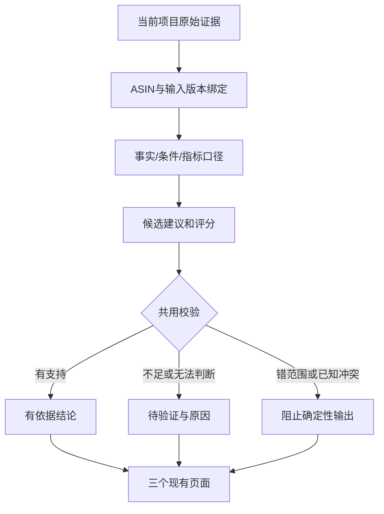

## Context

See proposal.md — Why。以已确认计划为实施基线：`docs/superpowers/plans/2026-09-15-product-evidence-guardrails.md`。
现有 product-definition 契约具备 evidenceIds、输入指纹、requires-validation 和 grade:null；本地确定性分析仍有模板默认评分。雪地产品和灯具止血修复保留。

## Goals / Non-Goals

**Goals:** 小型纯函数与输入适配器贯通三个入口；已知冲突拒绝、证据不足待验证；缺失评分类型安全地传递到直接消费者。

**Non-Goals:** 不建全类目知识库、不另建服务/队列/数据库、不新增模型调用、不批量重写存档、不改市场调研/权限功能。共享工作区不整体提交、清理或重置。

## Decisions

1. `shared/analysis-evidence-policy.ts` 承载三态事实、来源范围与条件检查；`app/lib/analysis-evidence-adapter.ts` 从当前原始输入构造证据。复用 `shared/voc-context.ts`。相较每页关键词黑名单，这能保留来源和理由；但不宣称解决任意自然语言蕴含问题。
2. 输入包含来源定位、ASIN、原文；只在有明确声明时形成正/负属性。搜索词仅保留为搜索信号。未知来源的旧派生文本不能作为直接规格；单独合法 ID 不能证明任意结论。
3. 评分维度 nullable，缺任一原七维权重输入时综合分 null；有全套有效依据则使用原权重。不新造阈值，不以 0 或重归一化替代缺失。成本/合规单独标识，不能因需求分高而批准立项。
4. 保留 legacy 原始汇总兼容；新消费者增加指标口径，不将覆盖权重伪装成评论比例。负向条件保留至推荐边界，不同 ASIN 条件不混合。
5. 在本地 VOC/new-definition 和后端现有严格契约接入同一校验。普通不充分结论显示理由；错范围/指纹维持拒绝。优先沿用既有输出状态，避免持久化 schema 破坏性变更。

## Risks / Trade-offs

- 自由文本条件复杂 → 未可靠识别的工程语义保持待验证；回归已知否定/条件案例，不承诺全语义推理。
- nullable 影响旧消费者 → 全局搜索评分字段，只改直接消费者，类型检查发现遗漏；禁止强制断言掩盖空值。
- 保守判断可能降低结论数量 → 加正例测试，有明确规格的轮式产品/置物灯仍能分析。
- 共享文件变化 → 修改前读当前内容，仅针对本变更补丁，不还原他人修改。

## Migration Plan

不需要数据库迁移。依次：事实校验与雪地实例 → 未知评分及指标 → 三入口条件/建议校验 → 定向回归/typecheck → 正式栈受控发布与健康/源码指纹验证。旧存档不改写；新计算从原始输入重建。发布拒绝时保持待发布；回退仅通过既有正式栈代码版本机制，保留数据。
