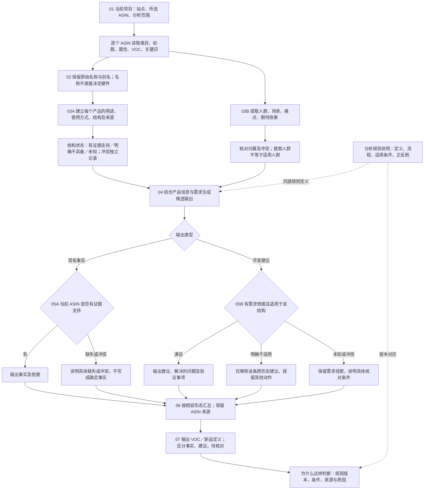

# 跨类目分析规则：业务审核基准 V1.0

本文件将用户已审核讨论的流程图纳入仓库，作为本变更的流程基准。对应下载文件“跨类目分析规则-业务审核流程图.pdf/png”（2026-09-16）；仓库规范以本文件及两份 spec 的行为要求为准，不依赖个人电脑下载路径。运营规则说明在此流程基础上呈现 R01–R12 的实际定义与版本。

新增的运营查看节点用于解释原流程，不改变其判定边界。未知类目不自动关闭分析；新增设计不要求竞品已经具备；任何分支都不得向其他 ASIN 传播结构事实。
